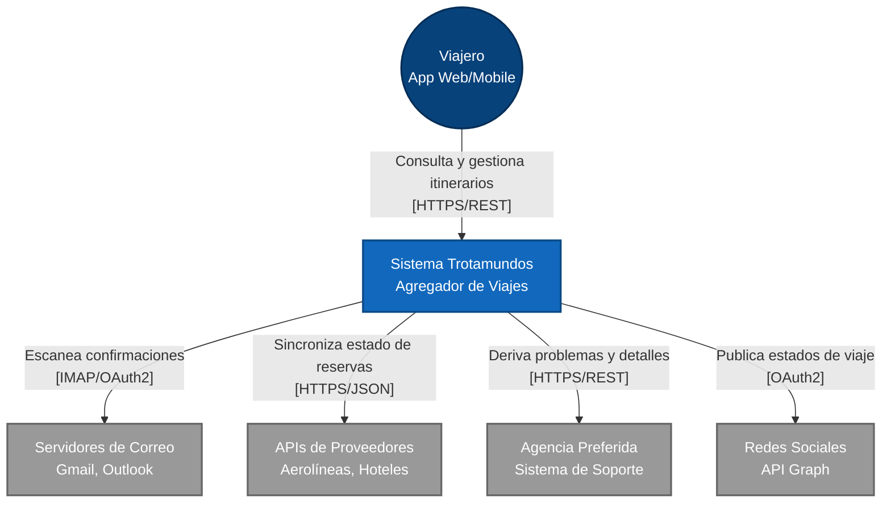
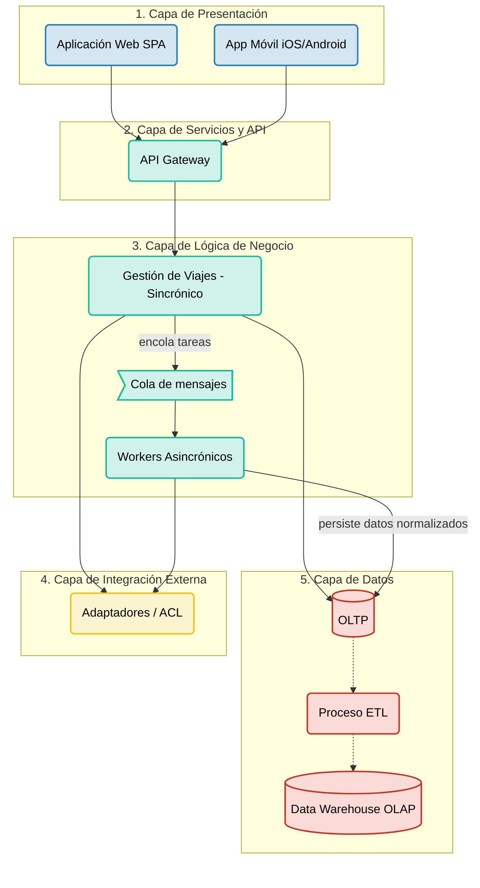

## Iteracion 1 

## Paso 1: Revision de entradas
  Al no tener entradas previas (Greenfield), este paso es salteado.

- - -

## Paso 2: Establecer el objetivo de la iteración seleccionando los drivers
Para asegurar que la base del diseño soporte las necesidades más críticas, se seleccionan los siguientes drivers arquitectónicos:
- **CRN-01 (Estructura General Greenfield):** Necesidad de definir el esqueleto principal que conecte a los usuarios con el backend.
- **CON-01 (Soporte Multiplataforma):** Obligación de soportar clientes Web y Móviles de forma estandarizada.
- **QA-07 (Escalabilidad):** El sistema base debe estar preparado físicamente para escalar y soportar 15 millones de cuentas y picos masivos.
- **QA-02 (Disponibilidad):** Operación global 24/7, lo que impide concentrar todo el sistema en un único punto de fallo.
- **CRN-02 / QA-01a (Desacoplamiento Asincrónico):** Necesidad de aislar el escaneo de correos del flujo principal de navegación del usuario.

- - - 

## Paso 3: Elegir uno o más elementos del sistema a refinar

Dado que el proyecto "Trotamundos" es un desarrollo *greenfield* (creado desde cero, según CRN-01) y esta es la primera iteración de diseño, no existe una estructura o arquitectura previa. 

Por lo tanto, el elemento seleccionado para refinar es el **Sistema Trotamundos en su totalidad**. En este punto, el sistema se considera como una "caja negra" que debe ser abierta para comenzar a particionarlo y definir sus responsabilidades lógicas y físicas iniciales.

- - -

## Paso 4: Seleccionar conceptos de diseño

Para dar soporte a los drivers arquitectónicos priorizados, se seleccionan los siguientes patrones y tácticas a nivel global:

*   **Patrón de Estructura - Arquitectura en Capas (N-Tier):** Se define un modelo de 5 capas para separar la presentación, el enrutamiento, las reglas de negocio, la integración y la persistencia (QA-05). Se utilizará un enfoque híbrido donde la Capa de Negocio orquesta a las capas de Integración y Datos en paralelo.
*   **Táctica de Desacoplamiento - Message Queuing:** Para absorber picos de tráfico y garantizar la asincronía (QA-01, CRN-02), se introduce una Cola de Mensajes (Publish-Subscribe) que separa la recepción de la solicitud de su procesamiento pesado en segundo plano.
*   **Táctica de Gestión de Datos - Proceso ETL:** Para cumplir con la separación de cargas transaccionales y analíticas (CRN-03), se implementa un proceso ETL (Extract, Transform, Load) que transfiere datos del entorno operacional al repositorio analítico sin afectar la performance en vivo.

- - - 

## Paso 5: Instanciar elementos arquitectónicos y asignar responsabilidades

En base a los conceptos elegidos, se instancian las 5 capas principales del sistema con las siguientes responsabilidades:

- **Capa de Presentación:** Contiene las aplicaciones cliente (Web SPA y Mobile). Es responsable exclusiva de la interfaz de usuario.
- **Capa de Servicios y API:** Actúa como API Gateway. Centraliza la seguridad, autenticación y enrutamiento hacia la lógica interna.
- **Capa de Lógica de Negocio (Orquestador Central):** Contiene el núcleo del sistema. Posee un módulo **Sincrónico** para atención inmediata al usuario, una **Cola de Mensajes** para encolar tareas pesadas, y un conjunto de **Workers Asincrónicos** que procesan reglas de negocio. Esta capa orquesta el flujo llamando a los adaptadores y persistiendo luego los datos.
- **Capa de Integración Externa:** Contiene los Adaptadores (Anti-Corruption Layer). Su única responsabilidad es traducir las comunicaciones con sistemas externos (correos, aerolíneas). **No interactúa con la base de datos**; devuelve la información normalizada a la Capa de Negocio.
- **Capa de Datos:** Se divide en dos repositorios desacoplados: una base **OLTP** para transacciones rápidas, un **Proceso ETL** que extrae y transforma la información periódicamente, y un Data Warehouse **OLAP** para las consultas analíticas del negocio.
  
- - - 

## Paso 6: Bosquejar vistas y registrar decisiones de diseño
En este paso se generan las representaciones visuales de la arquitectura base definida para Trotamundos y se formalizan las restricciones de diseño. Para esta iteración inicial, se proponen dos vistas fundamentales: la Vista de Contexto y la Vista Estructural de Capas.

- **Vista 1: Diagrama de Contexto (Nivel 1)**
Esta vista define los límites del sistema "Trotamundos" y expone todas sus interacciones con actores y sistemas externos, lo cual es crítico para visualizar el cumplimiento de los escenarios de Interoperabilidad (QA-03).

- **Vista 2: Diagrama Estructural de Capas (Arquitectura Base)**
Esta vista ilustra cómo se "abre la caja" del Sistema Trotamundos en 5 capas lógicas. La comunicación fluye de "arriba hacia abajo" (top-down) hasta llegar a la Capa de Lógica de Negocio, la cual actúa como orquestador central interactuando en paralelo con la Capa de Datos y la Capa de Integración. Este diseño aísla a los clientes de la complejidad de la persistencia y de los proveedores de terceros, garantizando la Mantenibilidad (QA-05).

**Registro de Decisiones de Diseño Clave:**

- **Aislamiento de Capas:** Se establece una restricción arquitectónica donde la Capa de Presentación desconoce por completo la existencia de la base de datos o de las APIs de terceros. Todo el tráfico hacia el backend debe pasar obligatoriamente por la Capa de Servicios (API Gateway).
- **División de Cargas:** Se decide separar la ejecución de tareas de usuario (sincrónicas) de las tareas de procesamiento en segundo plano (asincrónicas) dentro de la Capa de Negocio para proteger la latencia y la escalabilidad (QA-01 y QA-07).
- **Orquestación y Desacoplamiento Interno:** Se introduce una Cola de Mensajes dentro de la Capa de Negocio para separar la respuesta rápida al usuario del procesamiento pesado (workers asincrónicos), protegiendo la performance (QA-01).
- **Consistencia Analítica:** Se define un proceso ETL unidireccional que alimenta el Data Warehouse (OLAP) a partir de la base operacional (OLTP), garantizando que las consultas pesadas no impacten el sistema en vivo (CRN-03).
- **Independencia de Datos:** Se desacopla físicamente y lógicamente el almacenamiento de datos operacionales (OLTP) del almacenamiento analítico (OLAP).
- **Documentación detallada:** Consultar el [ADR-001: Selección del Estilo Arquitectónico General y Patrón de Despliegue](../adrs/adr-001-estilo-arquitectonico.md) que define la elección de la arquitectura Cliente-Servidor Multi-Tier en Capas, estableciendo las reglas de aislamiento de capas, separación de procesamiento sincrónico/asincrónico y segregación de datos OLTP/OLAP.

- - - 

## Paso 7: Analizar el diseño actual y evaluar el cumplimiento de los drivers

Con las vistas arquitectónicas definidas, se procede a evaluar cómo las decisiones tomadas en esta iteración abordan los requerimientos críticos (drivers) establecidos para "Trotamundos".

| Driver (Requerimiento) | Decisión Arquitectónica que lo aborda | Estado al final de la Iteración 1 |
| :--- | :--- | :--- |
| **UC-01 y UC-02** (Gestión de viajes manual y automática) | División de responsabilidades en 5 capas, con la Capa de Negocio actuando como orquestador central. | **Parcialmente Abordado:** Estructura general definida; falta el diseño de interfaces internas (Iteración 2). |
| **QA-01a y CRN-02** (Performance asincrónica y escaneo) | Implementación de una **Cola de Mensajes** y separación entre Módulo Sincrónico y Workers Asincrónicos. | **Abordado.** |
| **QA-03a, b, c, d** (Interoperabilidad general) | Creación de una Capa de Integración (Adaptadores) gestionada exclusivamente por la Lógica de Negocio. | **Abordado.** |
| **QA-05a, QA-05b** (Evolucionabilidad y Mantenibilidad) | Arquitectura en capas. Los adaptadores no tocan la BD, evitando el acoplamiento de datos con sistemas de terceros. | **Abordado.** |
| **CRN-03 y UC-03** (Separación de cargas y Analítica) | Implementación de un **Proceso ETL** que migra datos de la base operacional (OLTP) al Data Warehouse (OLAP). | **Abordado.** |
| **QA-01b, QA-01c** (Latencia Web y FCP Mobile) | Delegación visual a la SPA/Mobile y ruteo a través de un API Gateway. | **Parcialmente Abordado.** |
| **QA-02 y QA-07** (Disponibilidad y Escalabilidad ante picos) | Despliegue Multi-Tier y uso de colas para absorber picos (Backpressure). | **Parcialmente Abordado:** Falta definir nodos, réplicas y balanceadores en una iteración de infraestructura. |

**Conclusión de la Iteración 1:**
La arquitectura base elegida (Capas + Multi-Tier) ha demostrado ser sólida para estructurar el sistema y soporta desde el inicio los atributos críticos de interoperabilidad, mantenibilidad y separación de cargas. Sin embargo, para que los Casos de Uso primarios puedan ser implementados y documentados adecuadamente (habilitando el *Spec-driven development*), es indispensable detallar el interior de las capas clave.

- - -
