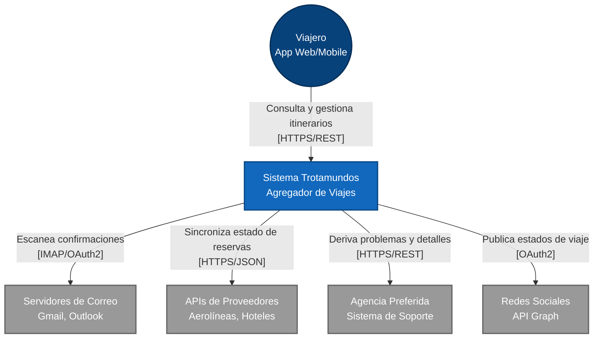
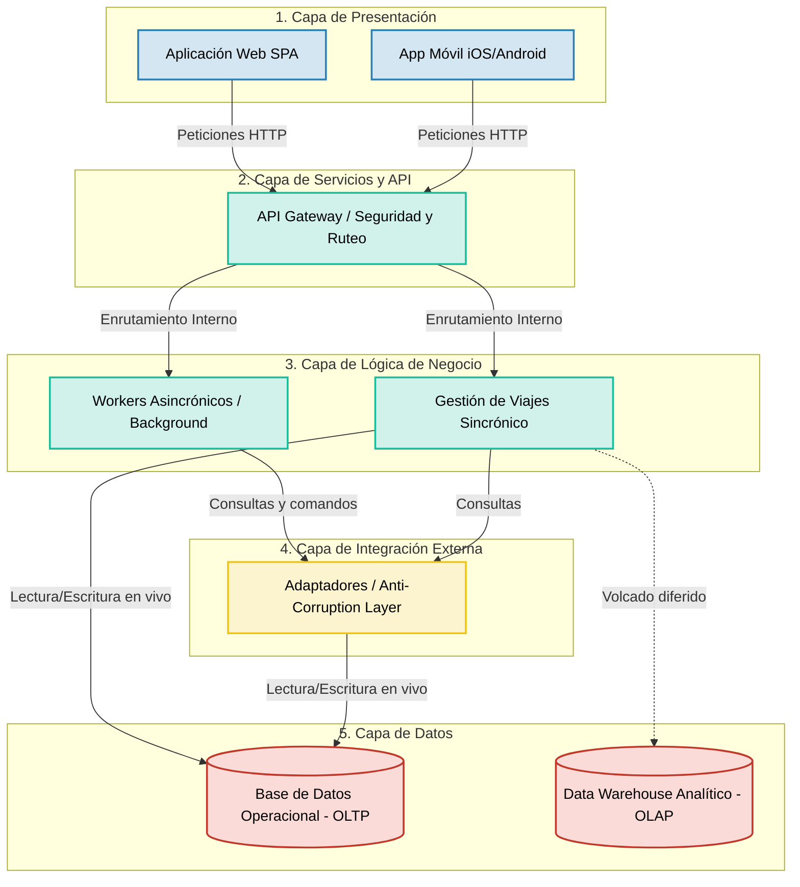

## Iteracion 1 

## Paso 1: Revision de entradas
  Al no tener entradas previas (Greenfield), este paso es salteado.

- - -

## Paso 2: Establecer el objetivo de la iteración seleccionando los drivers
Para asegurar que la base del diseño soporte las necesidades más críticas, se seleccionan los siguientes drivers arquitectónicos:
- **CRN-01 (Estructura General Greenfield):** Necesidad de definir el esqueleto principal que conecte a los usuarios con el backend.
- **CON-01 (Soporte Multiplataforma):** Obligación de soportar clientes Web y Móviles de forma estandarizada.
- **QA-07 (Escalabilidad):** El sistema base debe estar preparado físicamente para escalar y soportar 15 millones de cuentas y picos masivos.
- **QA-02 (Disponibilidad):** Operación global 24/7, lo que impide concentrar todo el sistema en un único punto de fallo.
- **CRN-02 / QA-01a (Desacoplamiento Asincrónico):** Necesidad de aislar el escaneo de correos del flujo principal de navegación del usuario.

- - - 

## Paso 3: Elegir uno o más elementos del sistema a refinar

Dado que el proyecto "Trotamundos" es un desarrollo *greenfield* (creado desde cero, según CRN-01) y esta es la primera iteración de diseño, no existe una estructura o arquitectura previa. 

Por lo tanto, el elemento seleccionado para refinar es el **Sistema Trotamundos en su totalidad**. En este punto, el sistema se considera como una "caja negra" que debe ser abierta para comenzar a particionarlo y definir sus responsabilidades lógicas y físicas iniciales.

- - -

## Paso 4: Elegir los conceptos de diseño que satisfacen los drivers seleccionados

Para esta primera iteración, la decisión arquitectónica principal es adoptar un estilo híbrido: Arquitectura Lógica de Capas (Layers) desplegada sobre un modelo físico Cliente-Servidor Multi-Tier (N-Tier). Esta selección permite establecer una estructura general robusta para el sistema greenfield.

**Justificación de la decisión:**

- **Soporte funcional y modularidad (CRN-01 y CON-03)**: El patrón de Layers organiza el código separando estrictamente la interfaz de usuario, la lógica de negocio, la integración de APIs externas y el acceso a datos. Esto permite un desarrollo guiado por especificaciones ordenado y facilita la construcción del prototipo por etapas.
- **Soporte multiplataforma (CON-01)**: El modelo Cliente-Servidor aísla completamente las aplicaciones cliente (Web y Móvil) de la infraestructura central, comunicándose únicamente a través de APIs estándar.
- **Escalabilidad y Disponibilidad (QA-07 y QA-02)**: El patrón Multi-Tier permite que cada capa lógica se despliegue en clústeres de servidores físicos independientes. Ante picos masivos de tráfico, la capa de Lógica de Negocio (Backend) puede escalar horizontalmente sin afectar a los clientes ni a los servidores de bases de datos.
- **Desacoplamiento asincrónico (CRN-02 y QA-01a)**: Dentro de la capa de lógica de negocio, se aislará el procesamiento de correos mediante sub-módulos de Workers Asincrónicos (procesamiento en segundo plano), garantizando que los hilos de respuesta web no se bloqueen.

- - - 

## Paso 5: Instanciar elementos arquitectónicos y asignar responsabilidades

A partir del estilo de Capas (Layers) y Cliente-Servidor Multi-Tier seleccionado, se "abre la caja" del sistema Trotamundos y se instancian las siguientes capas lógicas principales, asignándoles las responsabilidades que cubren la funcionalidad primaria (UC-01, UC-02 y UC-03):

**1. Capa de Presentación (Client Layer)**
*   **Responsabilidad:** Renderizar la interfaz de usuario, capturar la interacción y mostrar los itinerarios.
*   **Elementos:** Aplicación Web (SPA) y Aplicación Móvil (iOS/Android) (cumpliendo *CON-01*).
*   **Mapeo Funcional:** Soporta la interacción del **UC-02**, permitiendo al usuario visualizar, crear o modificar reservas manualmente.

**2. Capa de Servicios y API (API Gateway / Services Layer)**
*   **Responsabilidad:** Actuar como único punto de entrada al backend. Manejar el enrutamiento de peticiones, la autenticación, la gestión de sesiones y la validación de seguridad (*QA-04*).
*   **Mapeo Funcional:** Expone los *endpoints* (API REST/GraphQL) necesarios para que las aplicaciones cliente ejecuten el **UC-02**.

**3. Capa de Lógica de Negocio (Business Logic Layer)**
*   **Responsabilidad:** Ejecutar las reglas core de "Trotamundos". Se divide internamente para manejar el tráfico sincrónico y asincrónico.
*   **Elementos:**
    *   *Módulo de Gestión de Viajes (Sincrónico):* Procesa las peticiones en vivo de los usuarios (agrupación de itinerarios y ciclo de vida para el **UC-02**).
    *   *Módulo de Workers Asincrónicos (Procesamiento en background):* Hilos de ejecución dedicados a realizar el sondeo y escaneo periódico de correos (*CRN-02*). Garantiza la ejecución del **UC-01** sin bloquear la navegación del usuario (*QA-01a*).

**4. Capa de Integración Externa (Integration Layer)**
*   **Responsabilidad:** Manejar la interoperabilidad y aislar al núcleo del sistema de los cambios en las APIs de terceros (*QA-03*).
*   **Elementos:** Adaptadores (Adapters/Anti-Corruption Layers) para APIs de Aerolíneas, Hoteles y clientes de correo (IMAP/OAuth2).
*   **Mapeo Funcional:** Soporta directamente el **UC-01**, normalizando la información que llega de distintas fuentes antes de pasarla a la capa de negocio.

**5. Capa de Datos (Data Layer)**
*   **Responsabilidad:** Persistencia, almacenamiento y recuperación eficiente de la información, separando las cargas de trabajo (*CRN-03*).
*   **Elementos:**
    *   *Base de Datos Operacional (OLTP):* Almacena el estado actual de los viajes, usuarios y configuraciones para las consultas rápidas y en vivo (**UC-01** y **UC-02**).
    *   *Repositorio Analítico / Data Warehouse (OLAP):* Base de datos segregada físicamente que consolida tendencias e histórico de viajes. Permite que el equipo de datos ejecute consultas pesadas para monetización (**UC-03**) sin degradar la performance de los usuarios activos.

- - - 

## Paso 6: Bosquejar vistas y registrar decisiones de diseño
En este paso se generan las representaciones visuales de la arquitectura base definida para Trotamundos y se formalizan las restricciones de diseño. Para esta iteración inicial, se proponen dos vistas fundamentales: la Vista de Contexto y la Vista Estructural de Capas.

- **Vista 1: Diagrama de Contexto (Nivel 1)**
Esta vista define los límites del sistema "Trotamundos" y expone todas sus interacciones con actores y sistemas externos, lo cual es crítico para visualizar el cumplimiento de los escenarios de Interoperabilidad (QA-03).

- **Vista 2: Diagrama de Componentes y Conectores (Arquitectura Base)**

Esta vista ilustra cómo se "abre la caja" del Sistema Trotamundos en 5 capas lógicas. La comunicación fluye principalmente de "arriba hacia abajo" (*top-down*), organizando la estructura mediante dos reglas de dependencia distintas:   

1. **Capas Estrictas (*Strict Layering*):** Las capas superiores (**1. Capa de Presentación** y **2. Capa de Servicios/API**) operan bajo una regla estricta. La Capa de Presentación se comunica únicamente con el API Gateway, aislando a los clientes de la complejidad interna del backend, la base de datos y los servicios de terceros, lo que garantiza la mantenibilidad y evolucionabilidad de la interfaz (**QA-05**).   
2. **Capa de Negocio como Orquestador Central (*Layer Bridging*):** A partir de la **3. Capa de Lógica de Negocio**, la regla de desacoplamiento se flexibiliza. Esta capa actúa como el orquestador del sistema e interactúa directamente en paralelo con dos capas inferiores distintas: la **4. Capa de Integración Externa** (para traducir las comunicaciones externas) y la **5. Capa de Datos** (para persistir los cambios).

**Registro de Decisiones de Diseño Clave:**

- **Aislamiento de Capas:** Se establece una restricción arquitectónica donde la Capa de Presentación desconoce por completo la existencia de la base de datos o de las APIs de terceros. Todo el tráfico hacia el backend debe pasar obligatoriamente por la Capa de Servicios (API Gateway).
- **División de Cargas:** Se decide separar la ejecución de tareas de usuario (sincrónicas) de las tareas de procesamiento en segundo plano (asincrónicas) dentro de la Capa de Negocio para proteger la latencia y la escalabilidad (QA-01 y QA-07).
- **Independencia de Datos:** Se desacopla físicamente y lógicamente el almacenamiento de datos operacionales (OLTP) del almacenamiento analítico (OLAP), previniendo que las consultas pesadas de negocio degraden la disponibilidad del usuario final (CRN-03).
- **Documentación detallada:** Consultar el [ADR-001: Selección del Estilo Arquitectónico General y Patrón de Despliegue](../adrs/adr-001-estilo-arquitectonico.md) que define la elección de la arquitectura Cliente-Servidor Multi-Tier en Capas, estableciendo las reglas de aislamiento de capas, separación de procesamiento sincrónico/asincrónico y segregación de datos OLTP/OLAP.

- - - 

## Paso 7: Analizar el diseño actual y evaluar el cumplimiento de los drivers

Con las vistas arquitectónicas definidas, se procede a evaluar cómo las decisiones tomadas en esta iteración abordan los requerimientos críticos (drivers) establecidos para "Trotamundos".

| Driver (Requerimiento) | Decisión arquitectónica que lo aborda | Estado al final de la Iteración 1 |
| :--- | :--- | :--- |
| **CRN-01** (Estructura general) | Estilo en capas sobre despliegue Cliente-Servidor Multi-Tier (ADR-001) | **Abordado.** |
| **CON-01** (Multiplataforma) | Clientes Web y Móvil aislados detrás de un API Gateway (ADR-001) | **Abordado.** |
| **UC-01 y UC-02** (Gestión automática y manual) | Reparto de responsabilidades en 5 capas, con Negocio como orquestador central | **Parcialmente abordado:** estructura de alto nivel definida; falta diseñar las interfaces y la lógica interna (Iteración 2). |
| **QA-01a y CRN-02** (Performance asincrónica y escaneo de correos) | Cola de mensajes y workers separados del módulo sincrónico (ADR-002) | **Parcialmente abordado:** falta elegir el broker, definir reintentos e idempotencia, y dimensionar los workers para cumplir los 5 minutos. |
| **QA-03a, b, c, d** (Interoperabilidad) | Capa de Integración con adaptadores (Anti-Corruption Layer) gestionada por Negocio | **Parcialmente abordado:** cubre correo, aerolíneas y hoteles; faltan redes sociales y agencia preferida. |
| **QA-05** (Evolvability y Mantenibilidad) | Capas con aislamiento de dependencias externas; adaptadores sin acceso a datos | **Parcialmente abordado:** falta definir el mecanismo de extensión para nuevos medios de transporte. |
| **CRN-03 y UC-03** (Separación de cargas y analítica) | Bases OLTP/OLAP separadas con proceso ETL (ADR-003) | **Parcialmente abordado:** falta definir frecuencia y mecanismo del ETL. |
| **QA-01b, QA-01c** (Latencia web y FCP móvil) | Clientes separados y API Gateway | **Parcialmente abordado:** faltan componentes concretos de frontend y red. |
| **QA-07** (Escalabilidad) | Despliegue Multi-Tier y nivelación de carga con la cola | **Parcialmente abordado:** la estructura permite escalar horizontalmente; faltan balanceo, caché y estrategia de datos. |
| **QA-02** (Disponibilidad) | Ausencia de punto único de falla a nivel de tiers (Gateway replicado) | **Parcialmente abordado:** faltan réplicas, failover y health checks, a definir en una iteración de infraestructura. |
| **QA-04** (Seguridad) | — | **No tratado.** Objetivo propuesto para la Iteración 2. |
| **Usabilidad e Internacionalización** | — | **No tratado.** |
| **Módulo avanzado (Opción A o B)** | — | **No tratado.** |

**Conclusión de la Iteración 1:**
La arquitectura base elegida (Capas + Multi-Tier) ha demostrado ser sólida para estructurar el sistema y soporta desde el inicio los atributos críticos de interoperabilidad, mantenibilidad y separación de cargas. Sin embargo, para que los Casos de Uso primarios puedan ser implementados y documentados adecuadamente (habilitando el *Spec-driven development*), es indispensable detallar el interior de las capas clave.

- - -
