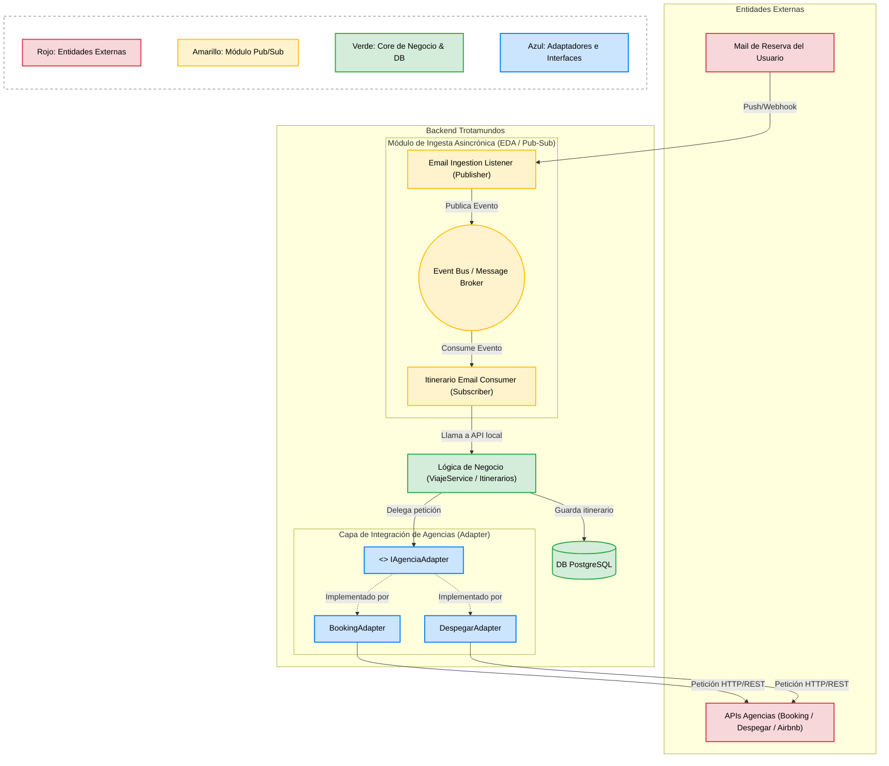
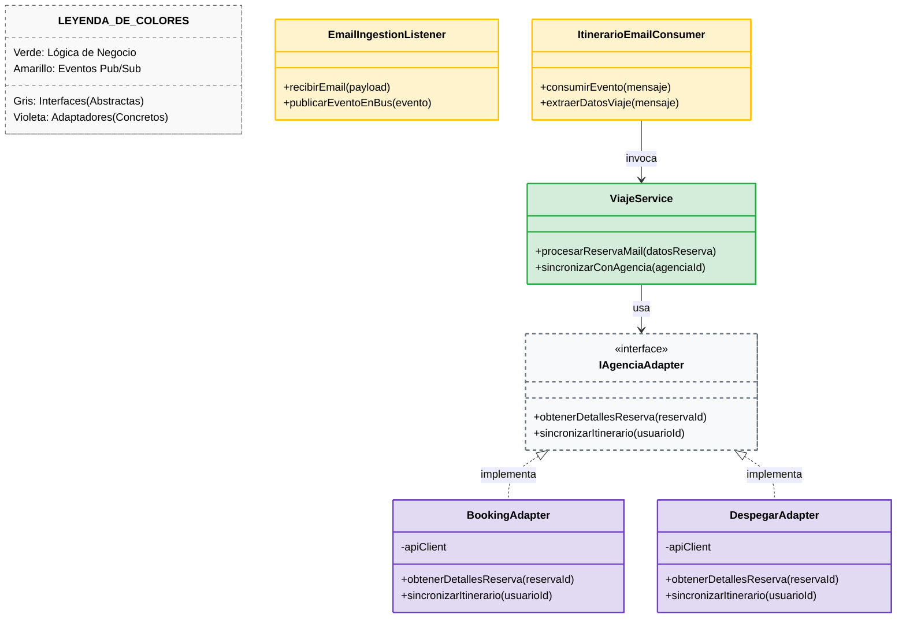

# Iteración 2: Refinamiento de la Lógica Core y las Integraciones

## Paso 1: Revisión de entradas

Se revisan las entradas disponibles al iniciar esta segunda iteración:

*   **Diseño existente (Resultado de la Iteración 1):** Arquitectura base en 5 capas lógicas desplegada sobre un modelo físico Cliente-Servidor Multi-Tier, con segregación de datos OLTP/OLAP y la introducción del patrón de desacoplamiento asincrónico.
*   **Estado del Backlog de Drivers:**
    *   **Completamente Abordados:**
        *   `CRN-01` (Estructura general greenfield).
        *   `CON-01` (Soporte multiplataforma web/móvil).
    *   **Parcialmente Abordados:**
        *   `UC-01` y `UC-02` (Estructura de alto nivel definida; falta la lógica interna y contratos de API).
        *   `QA-01a` / `CRN-02` (Estructura desacoplada definida; falta especificar el broker de mensajes, reintentos y workers).
        *   `QA-03a, b` (Capa de integración definida; falta estructurar adaptadores y parsers específicos).
        *   `QA-05a, b` (Aislamiento conceptual definido; falta el mecanismo de extensión mediante Anti-Corruption Layer).
        *   `CRN-03` / `UC-03` (Segregación OLTP/OLAP definida; falta el mecanismo de sincronización ETL).
        *   `QA-01b, c` (Falta definir componentes concretos de red y optimizaciones de frontend).
        *   `QA-02` y `QA-07` (Estructura Multi-Tier lista; falta la topología de redundancia y auto-escalado).
    *   **No Tratados:**
        *   `QA-03c y d` (Interoperabilidad).
        *   `QA-04a, b, c, d` (Seguridad y privacidad).
        *   `QA-06` (Usabilidad y Módulo Internacionalización).

## Paso 2: Establecer el objetivo de la iteración seleccionando los drivers

**Objetivo de la iteración:** Diseñar la estructura interna de la **Capa de Lógica de Negocio** y de la **Capa de Integración Externa**, detallando la arquitectura del broker de mensajes, los adaptadores mediante el patrón *Anti-Corruption Layer (ACL)* y los submódulos de dominio necesarios para soportar los casos de uso principales (`UC-01` y `UC-02`) y permitir el desarrollo guiado por especificaciones (*Spec-Driven Development*).

**Drivers seleccionados para abordar en esta iteración:**
*   **UC-01 — Unificación e Integración Automática de Reservas:** Ingesta y escaneo asincrónico de correos de usuarios.
*   **UC-02 — Gestión Manual y Ciclo de Vida del Viaje:** Creación, edición, eliminación y agrupación manual de reservas por itinerario.
*   **QA-01a — Performance Asincrónica:** Garantizar que las actualizaciones de correos se procesen y reflejen en el itinerario en menos de 5 minutos.
*   **QA-03a/b — Interoperabilidad:** Conexión con servidores de correo (OAuth2/IMAP) y APIs de proveedores (aerolíneas, hoteles).
*   **QA-05a/b — Evolucionabilidad y Mantenibilidad:** Aislar los cambios en formatos de respuesta o políticas de proveedores externos dentro de adaptadores dedicados.
*   **CON-02 — Protocolos de Correo:** Respetar OAuth2 e IMAP para el escaneo de e-mails.
*   **CON-03 — Spec-Driven Development:** Definir contratos claros entre componentes que permitan especificar las APIs antes de la codificación.

## Paso 3: Elegir uno o más elementos del sistema a refinar

De las 5 capas lógicas instanciadas en la Iteración 1, se seleccionan dos capas para realizar un refinamiento interno (*zoom-in*):

1.  **Capa de Lógica de Negocio:** Se abre el "orquestador central" para definir los servicios sincrónicos de itinerario, la cola de mensajes y los componentes consumidores (*Workers*).
2.  **Capa de Integración Externa:** Se abren los adaptadores para precisar cómo se traducen e ingresan los datos de terceros hacia el modelo de dominio intern

---

## Paso 4: Elegir los conceptos de diseño que satisfacen los drivers seleccionados

Para dar soporte a la lógica core y a las integraciones del sistema (resolviendo los *drivers* priorizados para esta iteración), se evalúan y seleccionan patrones arquitectónicos y tácticas específicas de atributos de calidad basados en el catálogo de Bass et al.

A continuación, se detallan los dos conceptos de diseño principales seleccionados, las alternativas descartadas, sus pros/contras y los *drivers* que abordan.

### 1. Patrón: Anti-Corruption Layer (ACL) / Adaptadores (Wrappers)
**Táctica Asociada:** *Tailor Interface / Encapsulate* (Empaquetar / Aislar Cambios).

- **Por qué elegimos esta opción:**
  Las APIs de agencias externas (como Booking, Despegar o Airbnb) tienen modelos de datos heterogéneos y políticas que cambian con frecuencia. Necesitamos una capa traductora mediadora que envase esta complejidad en adaptadores concretos (`BookingAdapter`, `DespegarAdapter`) implementando una interfaz unificada (`IAgenciaAdapter`). Esto aísla completamente el núcleo del backend (`ViajeService`), limitando la "onda de choque" de cualquier cambio externo a un único componente aislado.
- **Drivers que aborda:**
  * **QA-05a / QA-05b** (Evolucionabilidad y Mantenibilidad).
  * **QA-03a / QA-03b** (Interoperabilidad con proveedores).

| Opción Evaluada | Pros | Contras | Decisión |
| :--- | :--- | :--- | :--- |
| **Opción A: Anti-Corruption Layer (ACL) e Interfaces** | - Aísla al Core (ViajeService) de cambios externos. - Permite resolver actualizaciones de terceros en menos de 2 días-persona (**QA-05b**). - Facilita agregar nuevas agencias sin tocar el código central (**QA-05a**). | - Introduce un ligero *overhead* de procesamiento por la traducción de datos. - Requiere mayor esfuerzo inicial para definir las interfaces abstractas.  **Mitigación de Trade-offs:** El *overhead* se minimiza utilizando librerías de mapeo eficientes (ej. MapStruct o equivalentes). El esfuerzo de diseño inicial se acota definiendo primero un modelo unificado básico y construyendo los adaptadores de forma iterativa solo cuando se necesite integrar una nueva agencia. | **Seleccionada.** |
| **Opción B: Integración Directa (Punto a Punto)** | - Desarrollo inicial más rápido. - Menor cantidad de clases y abstracciones en el código. | - Alto acoplamiento. Cualquier cambio en la API de Despegar rompe la lógica de negocio core. - Imposibilita cumplir con la mantenibilidad requerida (**QA-05**). | *Descartada.* |

---

### 2. Patrón: Publish-Subscribe / Broker de Mensajes (Cola Asincrónica)
**Táctica Asociada:** *Asynchronous Interaction / Manage Queue Size* (Manejo de Respuestas Asincrónicas).

- **Por qué elegimos esta opción:**
  La recepción y *parsing* de correos es un proceso que no debe bloquear el sistema. Al usar un patrón *Event-Driven* con un *Message Broker* (`EventBus`), los emisores (`EmailIngestionListener`) publican eventos de nuevos correos sin conocer a los receptores. Los *workers* asincrónicos (`ItinerarioEmailConsumer`) consumen estos eventos de forma desacoplada, nivelando la carga para garantizar que los itinerarios se reflejen rápidamente en la base de datos sin degradar la latencia de navegación de los usuarios.
- **Drivers que aborda:**
  * **QA-01a** (Performance - Sincronización asincrónica en menos de 5 minutos).
  * **CRN-02** (Desacoplamiento de procesamiento asincrónico).
  * **QA-07a** (Escalabilidad - Amortiguación de picos extremos).

| Opción Evaluada | Pros | Contras | Decisión |
| :--- | :--- | :--- | :--- |
| **Opción A: Publish-Subscribe mediante Event Bus** | - Desacopla totalmente la ingesta (Listener) del procesamiento (Consumer). - Amortigua picos de tráfico de correos. - Garantiza que los hilos HTTP del usuario no se bloqueen. | - Añade complejidad de infraestructura (hay que mantener un Bus/Broker). - La trazabilidad de los eventos asincrónicos es más compleja.  **Mitigación de Trade-offs:** La complejidad de infraestructura se reduce delegando el Message Broker a un servicio gestionado en la nube (Paas/Managed Service como AWS SQS/SNS o RabbitMQ alojado). La trazabilidad se asegura implementando un **Correlation ID** único inyectado desde el Listener, el cual viaja con el mensaje y se registra en todos los logs de los workers para rastrear el ciclo de vida completo del evento. | **Seleccionada.** |
| **Opción B: Procesamiento Sincrónico Directo In-Memory** | - Arquitectura mucho más simple (sin infraestructura extra). - Trazabilidad y debugging directo en el mismo hilo de ejecución. | - Ante un pico de correos, los hilos se agotan y el servidor colapsa (**QA-07a**). - Si el servidor se reinicia, se pierden los correos en memoria. | *Descartada.* |
---

## Paso 5: Instanciar elementos arquitectónicos y asignar responsabilidades

A partir de los patrones seleccionados en el Paso 4, procedemos a hacer "zoom-in" e instanciar los componentes internos. Nos concentraremos en reflejar fielmente la estructura definida en las vistas arquitectónicas de componentes y módulos.

### 1. Capa de Presentación y API Gateway
*   Permanecen aisladas de la complejidad del backend. Enrutan las peticiones HTTP entrantes directamente hacia los *Controllers*, comunicándose exclusivamente mediante **DTOs (Data Transfer Objects)** planos.

### 2. Módulo de Ingesta Asincrónica (EDA / Pub-Sub)
Instancia el patrón Publish-Subscribe para el manejo de correos:
*   **EmailIngestionListener (Publisher):** Punto de entrada de los correos (vía Push/Webhook o IMAP). Recibe el payload bruto y publica un evento genérico en el bus, liberando el hilo inmediatamente.
*   **Event Bus / Message Broker:** La infraestructura de mensajería que absorbe la carga pesada y retiene los eventos hasta que puedan ser procesados.
*   **ItinerarioEmailConsumer (Subscriber):** Actúa como *Worker* en segundo plano. Escucha el bus de mensajes, extrae los datos del viaje del evento y llama a la lógica de negocio sincrónica para actualizar el sistema.

### 3. Capa de Lógica de Negocio (Backend Core)
Es el orquestador central y corazón del sistema, protegido de la infraestructura externa:
*   **ViajeService:** Módulo central del dominio que gestiona los flujos de la aplicación (ej. `procesarReservaMail`, `sincronizarConAgencia`). Orquesta la lógica y delega la integración externa exclusivamente a través de contratos abstractos (`IAgenciaAdapter`), ignorando las implementaciones concretas.

### 4. Capa de Integración de Agencias (Adapter / ACL)
Materializa el patrón *Anti-Corruption Layer (ACL)* aislando al dominio de los cambios de terceros:
*   **IAgenciaAdapter:** Interfaz que define el contrato estandarizado (`obtenerDetallesReserva`, `sincronizarItinerario`) que `ViajeService` espera consumir.
*   **BookingAdapter / DespegarAdapter:** Implementaciones concretas. Envuelven la comunicación HTTP/REST con las APIs específicas de cada agencia, mapean sus formatos propietarios (JSON/XML) y los traducen al modelo interno de Trotamundos. Ninguno de estos adaptadores tiene acceso a la base de datos.

### 5. Capa de Datos (Persistencia)
*   **DB PostgreSQL:** Base de datos relacional operacional (OLTP) donde la Capa de Lógica de Negocio almacena los itinerarios procesados y unificados, aislada de la ingesta de correos y de las respuestas de las agencias.
---

### Paso 6: Definir Interfaces y Vistas Arquitectónicas (C&C y Módulos)
En este paso se formalizan los contratos de interfaz y se construyen las vistas estáticas y dinámicas que documentan el comportamiento de la capa de integración de agencias (patrón Adapter) y el procesamiento asincrónico de correos (patrón Publisher-Subscriber).

### Vista 1: Vista C&C (Componentes y Conectores - Tiempo de Ejecución)
Esta vista modela el comportamiento dinámico del sistema en tiempo de ejecución, mostrando cómo fluyen las peticiones de integración y los eventos asincrónicos de correos a través de la red y el bus de mensajes.

#### Leyenda y Explicación de la Vista 1 (C&C)
* **UserMail → EmailIngestion (Webhook/IMAP):** Entrada del correo enviado por el usuario con su comprobante de reserva.
* **EmailIngestion (Publisher):** Recibe el correo bruto, extrae los metadatos básicos y publica un evento `NuevoMailReservaEvent` de forma asincrónica.
* **EventBus (Message Broker):** Conector de desacoplamiento temporal y espacial que distribuye eventos a los suscriptores interesados.
* **EmailSubscriber (Subscriber):** Escucha el tópico de eventos de correo, parsea la información y convoca a la lógica de dominio.
* **IAgenciaAdapter + Adaptadores:** Capa intermedia que homogeneiza las respuestas heterogéneas de las APIs externas (Booking, Despegar) hacia un modelo de datos unificado dentro de Trotamundos.
* **DB (PostgreSQL):** Almacenamiento final relacional donde la lógica de negocio guarda el itinerario actualizado.

---

### Vista 2: Vista de Módulos (Estructura de Código / Clases e Interfaces)
Esta vista representa la organización estática del código fuente, las interfaces y las relaciones de dependencia bajo la regla de dependencias allowed-to-use.

#### Leyenda y Explicación de la Vista 2 (Módulos)
* **ViajeService:** Módulo central del dominio que contiene la lógica de negocio para armar itinerarios. Solo conoce la interfaz `IAgenciaAdapter` y desconoce la existencia de las agencias específicas.
* **IAgenciaAdapter:** Contrato que define las operaciones estándar que el dominio requiere de cualquier agencia externa. Actúa como barrera de protección frente a cambios de terceros.
* **BookingAdapter / DespegarAdapter:** Implementaciones concretas de la interfaz. Encapsulan la lógica específica, endpoints, y mapeo de datos de cada API externa para transformarlos al modelo interno de Trotamundos.
* **EmailIngestionListener & ItinerarioEmailConsumer:** Clases encargadas de la ingesta asincrónica. El Listener publica el evento al bus, mientras que el Consumer lo escucha e inicia el procesamiento en el dominio.

---

## Paso 7: Evaluar el diseño actual y revisar el backlog de drivers

**Evaluación de la Iteración 2 respecto a los objetivos del Paso 2:**
El diseño de esta iteración abordó con éxito el núcleo del problema de integración y concurrencia. Mediante la introducción de los patrones **Anti-Corruption Layer (ACL)** y **Publish-Subscribe**, se logró el desacoplamiento crítico para procesar correos asincrónicamente mediante `EmailIngestionListener` e `ItinerarioEmailConsumer` (`QA-01a`, `CRN-02`). Además, se protegió la lógica core (`ViajeService`) de los cambios volátiles en las APIs de terceros mediante adaptadores concretos bajo la interfaz `IAgenciaAdapter` (`QA-05a/b`, `QA-03a/b`). 

**Qué faltó o quedó parcialmente cubierto:**
*   **CON-02 (OAuth2/IMAP):** Aunque se instanció la ingesta de correos genérica en el diseño, los adaptadores específicos para lidiar con la complejidad de la autenticación OAuth2 y el protocolo IMAP con proveedores como Gmail/Outlook no fueron modelados en detalle en la vista de clases.
*   **UC-02 (Gestión Manual de Viaje):** El flujo de gestión manual quedó subsumido dentro de las responsabilidades generales del `ViajeService`, pero no se detallaron en profundidad los contratos de las operaciones CRUD ni cómo se exponen hacia la capa de presentación mediante Spec-Driven Development (`CON-03`).

A continuación, se actualiza el estado del backlog general basándose en los resultados de la Iteración 1 y 2, utilizando el formato estándar del método ADD para el proyecto Trotamundos.

### Estado actualizado del Backlog de Drivers (Fin de Iteración 2)

| ID Driver | Descripción / Atributo | Estado Actual | Comentarios / Resolución |
| :--- | :--- | :--- | :--- |
| **CRN-01** | Estructura general greenfield | Completamente Abordado | Resuelto en la Iteración 1 (Multi-Tier, MVC/API). |
| **CON-01** | Soporte multiplataforma | Completamente Abordado | Resuelto en la Iteración 1 (Backend for Frontend / API Gateway). |
| **QA-01a / CRN-02**| Performance Asincrónica (< 5m) | Completamente Abordado | Resuelto en Iteración 2 con Message Broker y patrón Pub-Sub. |
| **QA-03a,b / QA-05a,b**| Interoperabilidad y Mantenibilidad | Completamente Abordado | Resuelto en Iteración 2 con Anti-Corruption Layer e Interfaces (`IAgenciaAdapter`). |
| **QA-03c,d**| Interoperabilidad | Parcialmente Abordado | Pendiente conexión con redes sociales y agencia preferida |
| **UC-01** | Unificación automática (Mails) | Completamente Abordado | Resuelto mediante la ingesta asincrónica (Listeners/Workers). |
| **CON-03** | Spec-Driven Development | Completamente Abordado | Bases establecidas mediante el uso de interfaces abstractas. |
| **CON-02** | Protocolos de correo OAuth2/IMAP | Parcialmente Abordado | Mencionados lógicamente, pero falta diseñar sus clases específicas. |
| **UC-02** | Gestión manual de viaje | Parcialmente Abordado | Base estructural de dominio lista (`ViajeService`); requiere detalle de endpoints. |
| **CRN-03 / UC-03** | Segregación OLAP/OLTP | Parcialmente Abordado | Base de datos dividida en Iteración 1; falta diseñar el proceso ETL/Sincronización. |
| **QA-01b, c** | Optimizaciones de Red y Front | No Tratado | Pendiente de definición de caché (ej. Redis/CDN) y paginación. |
| **QA-02 / QA-07** | Redundancia y Escalado (Picos) | No Tratado | Pendiente de topología física de despliegue (ej. balanceadores, orquestación). |
| **QA-04a,b,c,d** | Seguridad y Privacidad | No Tratado | Pendiente (Identity Provider, autenticación, encripción de datos sensibles). |
| **QA-06** | Usabilidad e Internacionalización | No Tratado | Pendiente de definición en componentes de frontend y diccionarios de internacionalización. |

**Conclusión para el próximo ciclo:**
La **Iteración 3** deberá enfocarse en cerrar las brechas de infraestructura física, seguridad e integridad de datos. Los principales candidatos para el próximo objetivo son **Seguridad y Privacidad (`QA-04`)**, el mecanismo de **Sincronización de Datos ETL (`CRN-03 / UC-03`)** para nutrir el motor de reportes, y la **Topología de Despliegue de Alta Disponibilidad (`QA-02 / QA-07`)** que determine cómo escalar dinámicamente los workers asincrónicos definidos en esta etapa.
