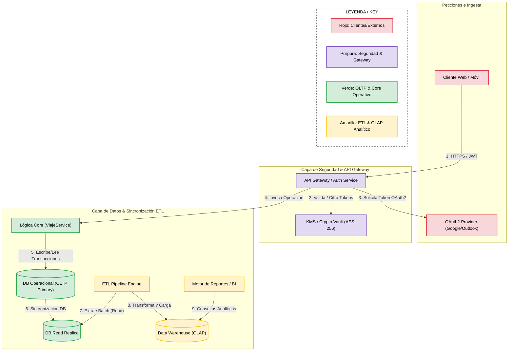
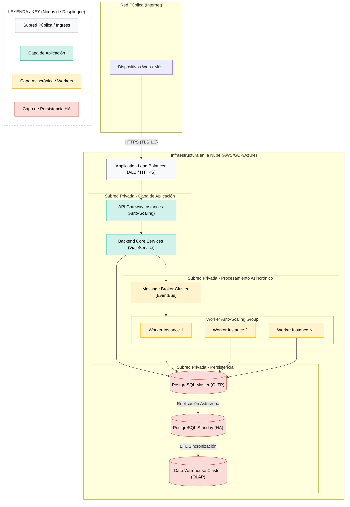

# Iteración 3: Seguridad, Sincronización ETL y Topología de Despliegue

## Paso 1: Revisión de entradas

Se revisan las entradas disponibles al iniciar esta tercera iteración:

* **Diseño existente (Resultado de las Iteraciones 1 y 2):** Arquitectura base Multi-Tier en 5 capas lógicas, segregación de datos OLTP/OLAP, patrón Publish-Subscribe con Message Broker para la ingesta asincrónica de correos, y patrón Anti-Corruption Layer (ACL) para aislar la lógica core (`ViajeService`) de los formatos heterogéneos de APIs externas.
* **Estado del Backlog de Drivers:**
  * **Completamente Abordados:**
    * `CRN-01` (Estructura general greenfield).
    * `CON-01` (Soporte multiplataforma web/móvil).
    * `QA-01a` / `CRN-02` (Performance asincrónica y escaneo < 5 min).
    * `QA-03a, b` / `QA-05a, b` (Interoperabilidad, evolucionabilidad y mantenibilidad con ACL).
    * `UC-01` (Unificación automática de reservas).
    * `CON-03` (Spec-Driven Development).
  * **Parcialmente Abordados:**
    * `CON-02` (Protocolos de correo OAuth2 / IMAP; falta especificar gestión de tokens y Handshake).
    * `UC-02` (Gestión manual de viaje; base lógica lista en `ViajeService`, requiere persistencia relacional).
    * `CRN-03` / `UC-03` (Segregación OLTP/OLAP definida; falta especificar el proceso ETL de sincronización).
  * **No Tratados:**
    * `QA-04a, b, c, d` (Seguridad, cifrado en reposo/tránsito y privacidad).
    * `QA-02` y `QA-07` (Redundancia, auto-escalado de workers y alta disponibilidad).
    * `QA-03c y d` (Interoperabilidad).
    * `QA-01b, c` (Optimizaciones de frontend, caché y latencia).
    * `QA-06` (Usabilidad e Internacionalización).

---

## Paso 2: Establecer el objetivo de la iteración seleccionando los drivers

**Objetivo de la iteración:** Diseñar e instanciar la infraestructura de la Capa de Datos (ETL/OLAP) para el motor analítico, la capa transversal de Seguridad y Privacidad (autenticación OAuth2, gestión de tokens y cifrado AES-256/TLS 1.3), y la Topología de Despliegue física para garantizar alta disponibilidad y auto-escalado horizontal ante picos de demanda.

**Drivers seleccionados para abordar en esta iteración:**
* **QA-04a, b, c, d — Seguridad y Privacidad:** Garantizar el resguardo seguro de credenciales y tokens OAuth2, el cifrado de datos personales en tránsito (TLS 1.3) y reposo (AES-256), y la autorización granular de itinerarios compartidos.
* **CRN-03 / UC-03 — Sincronización ETL y Reportes (OLTP vs OLAP):** Detallar el mecanismo y frecuencia del proceso ETL para sincronizar la base operacional (OLTP) con el Data Warehouse (OLAP) sin degradar la performance.
* **QA-02 / QA-07 — Alta Disponibilidad y Escalabilidad Masiva:** Diseñar la topología física con balanceadores de carga, clústeres redundantes y auto-escalado para absorber picos masivos de tráfico.
* **CON-02 — Protocolos de Correo e Identidad:** Integración segura con proveedores de identidad y correo mediante OAuth2.

---

## Paso 3: Elegir uno o más elementos del sistema a refinar

Dado que el core funcional de negocio e integración ya se resolvió en las iteraciones anteriores, se seleccionan los siguientes elementos y capas estructurales para realizar un refinamiento en detalle (zoom-in):

1. **Capa de Datos:** Se abre la persistencia relacional en PostgreSQL (OLTP) y se diseña el componente ETL Pipeline que extrae, transforma y carga la información hacia la base de datos analítica (OLAP).
2. **Capa de Seguridad y API Gateway (Transversal):** Se instancian los módulos Auth / OAuth2 Manager y Crypto Manager / KMS para gestionar credenciales, JWTs y cifrado.
3. **Infraestructura Física y Topología de Despliegue:** Se define la distribución física en la nube (nodos, Load Balancers, clústeres de Workers asincrónicos y réplicas de datos).

---

## Paso 4: Elegir los conceptos de diseño que satisfacen los drivers seleccionados

A partir del catálogo de tácticas y patrones de arquitectura, se evalúan y seleccionan las soluciones para los drivers priorizados:

### 1. Patrón: Batch ETL con CDC (Change Data Capture)
**Táctica Asociada:** Maintain Multiple Copies / Separate OLTP and OLAP Load / Prevent Resource Contention.

- **Por qué elegimos esta opción:**
  Las consultas analíticas pesadas (`UC-03`) pueden saturar la base transaccional si se ejecutan directamente sobre la base primaria. Se opta por un proceso de sincronización por lotes (*Batch ETL*) asistido por réplicas de lectura (CDC) que extrae los datos de PostgreSQL (OLTP), transforma los modelos relacionales a esquemas dimensionales, y los carga en el Data Warehouse (OLAP).
- **Drivers que aborda:** 
  * **CRN-03 / UC-03** (Segregación OLAP/OLTP y Generación de Reportes).

| Opción Evaluada | Pros | Contras | Decisión |
| :--- | :--- | :--- | :--- |
| **Opción A: Batch ETL / CDC Desacoplado** | - Cero impacto de lectura en las transacciones de usuarios en vivo. - Optimizado para consultas complejas de BI (Business Intelligence). | - Latencia de consistencia eventual en los reportes (minutos u horas).  **Mitigación de Trade-offs:** La latencia se mitiga definiendo un Acuerdo de Nivel de Servicio (SLA) claro con el equipo de negocio, acordando que el motor de reportes opera con datos consolidados tipo "T-1" (cierre del día anterior). Los procesos Batch más pesados se programan en ventanas temporales de bajo tráfico (madrugada). Si en el futuro el negocio exige métricas más rápidas, la base ya implementada con CDC permite escalar hacia flujos de *micro-batches* de baja latencia usando herramientas como Debezium. | **Seleccionada.** |
| **Opción B: Consultas Directas sobre DB Operacional** | - Datos analíticos en tiempo real sin infraestructura adicional. | - Alto riesgo de bloqueos de tablas (*locks*) y degradación crítica de la performance para los usuarios que están usando la app (`QA-01`). | *Descartada.* |
---

### 2. Patrón: Token-Based Authentication (OAuth2 / OIDC) & Envelope Encryption
**Táctica Asociada:** Authenticate / Authorize / Encrypt Data / Limit Access.

- **Por qué elegimos esta opción:**
  Para cumplir con `QA-04` y `CON-02`, el acceso a la plataforma se gestiona centralizadamente en el API Gateway validando tokens **JWT**. Los tokens de acceso de terceros (Gmail, Outlook) se cifran en reposo con claves administradas en un Key Vault/KMS.
- **Drivers que aborda:** `QA-04a,b,c,d`, `CON-02`.

| Opción Evaluada | Pros | Contras | Decisión |
| :--- | :--- | :--- | :--- |
| **Opción A: JWT + Envelope Encryption (KMS)** | - Seguridad de nivel empresarial y aislamiento perimetral. - Rotación segura de claves sin impactar al modelo. | - Mayor complejidad en la gestión de claves y revocaciones. | **Seleccionada.** |
| **Opción B: Guardado de tokens en texto plano** | - Menor esfuerzo de desarrollo inicial. | - Incumplimiento crítico de estándares de seguridad y privacidad (`QA-04`). | *Descartada.* |

---

### 3. Patrón: Statutory Auto-Scaling & Load-Balanced Cluster
**Táctica Asociada:** Horizontal Scaling / Redundancy / Health Monitoring.

- **Por qué elegimos esta opción:**
  Para garantizar alta disponibilidad (`QA-02`) y soportar picos masivos de procesamiento de correos (`QA-07`), el grupo de Workers asincrónicos (`ItinerarioEmailConsumer`) se ubica en un clúster con auto-escalado horizontal controlado dinámicamente por la métrica de mensajes en la cola del Event Bus.
- **Drivers que aborda:** `QA-02`, `QA-07`, `QA-01a`.

---

## Paso 5: Instanciar elementos arquitectónicos y asignar responsabilidades

A partir de los patrones seleccionados en el Paso 4, se instancian los componentes concretos de la arquitectura:

### 1. Capa de Seguridad y Autenticación
* **Auth / OAuth2 Manager:** Centraliza la validación de tokens JWT en el API Gateway y gestiona el flujo de autenticación con proveedores externos (Google/Microsoft).
* **Key Management Service (KMS) & Crypto Vault:** Administra claves simétricas de cifrado (AES-256) para cifrar datos sensibles e itinerarios privados antes de guardarlos en la persistencia.

### 2. Capa de Datos y Sincronización Analítica
* **PostgreSQL OLTP Primary:** Base de datos relacional transaccional (fuente primaria de escrituras y lecturas de usuarios).
* **PostgreSQL Read Replica:** Réplica de lectura síncrona/asíncrona que sirve como fuente de extracción para el pipeline de datos sin impactar a la instancia primaria.
* **ETL Pipeline Worker / Process:** Proceso por lotes que extrae cambios, transforma el modelo relacional a esquemas en estrella y carga los itinerarios consolidados en el Data Warehouse.
* **Data Warehouse (OLAP):** Repositorio analítico optimizado para el consumo exclusivo del motor de reportes y Business Intelligence.

### 3. Infraestructura y Despliegue Físico
* **Application Load Balancer (ALB):** Punto de entrada público que distribuye el tráfico HTTPS (TLS 1.3) entre las instancias del API Gateway.
* **Worker Auto-Scaling Group (ASG):** Clúster dinámico de Workers (`ItinerarioEmailConsumer`) que incrementa o reduce instancias físicas en función de los mensajes en cola.

---

## Paso 6: Definir Interfaces y Vistas Arquitectónicas

### Vista 1: Vista C&C (Mecanismo de Sincronización ETL y Seguridad)
Esta vista modela la interacción dinámica entre el flujo de autenticación perimetral, la ejecución transaccional operativa y la sincronización asincrónica ETL hacia la capa analítica.

#### Leyenda y Explicación de la Vista 1 (C&C)
1. **Autenticación y Cifrado:** Las peticiones ingresan por el API Gateway donde se validan los JWTs. Si se capturan credenciales OAuth2 para el escaneo de correo, el módulo KMS/Vault las cifra con AES-256 antes de persistir.
2. **Segregación OLTP/OLAP:** La base primaria `PostgreSQL OLTP Primary` atiende de forma dedicada las escrituras y lecturas operativas de los usuarios en tiempo real.
3. **Pipeline ETL:** El `ETL Engine` realiza lecturas exclusivamente sobre la `PostgreSQL Read Replica` para eliminar la contención de recursos sobre el sistema transaccional. Transforma los registros relacionales a un modelo estrella y los carga en el `Data Warehouse (OLAP)` para el motor de reportes.

---

### Vista 2: Vista de Despliegue (Topología Física y Alta Disponibilidad)
Esta vista asigna los componentes lógicos a la infraestructura física/virtualizada en la nube, garantizando disponibilidad y auto-escalado horizontal.

#### Leyenda y Explicación de la Vista 2 (Despliegue)
* **Application Load Balancer (ALB):** Recibe las conexiones cifradas en TLS 1.3 y distribuye el tráfico equitativamente entre las instancias de aplicación.
* **Worker Auto-Scaling Group (ASG):** Las instancias de los Workers (`ItinerarioEmailConsumer`) se escalan dinámicamente según la cantidad de mensajes pendientes en la cola del `Message Broker`.
* **Persistencia Alta Disponibilidad (HA):** La base relacional cuenta con una réplica *Standby* en modo Failover automático para tolerar caídas de nodos sin pérdida de datos.

---

## Paso 7: Evaluar el diseño actual y revisar el backlog de drivers

**Evaluación de la Iteración 3 respecto a los objetivos del Paso 2:**
El diseño de esta iteración resolvió exitosamente la infraestructura necesaria para garantizar el resguardo seguro de credenciales, cifrado y autorización (`QA-04a,b,c,d`). Adicionalmente, el pipeline ETL desacopló de forma completa el procesamiento operativo (OLTP) de la carga analítica (OLAP) (`CRN-03 / UC-03`). Por último, la vista de despliegue consolidó la topología física necesaria para auto-escalar los workers de ingesta y brindar alta disponibilidad (`QA-02`, `QA-07`).

**Qué faltó o quedó parcialmente cubierto:**
* **QA-01b, c (Optimizaciones de Frontend y Caché):** Aunque el backend escala dinámicamente, no se definió la capa de almacenamiento en caché en el borde (CDN) o en memoria (Redis) para reducir latencias en la navegación de itinerarios de alta demanda.
* **QA-06 (Usabilidad e Internacionalización):** Pendiente la especificación de componentes del cliente para la gestión de múltiples idiomas y zonas horarias.

A continuación, se actualiza el estado del backlog general basándose en los resultados acumulados de las Iteraciones 1, 2 y 3.

### Estado actualizado del Backlog de Drivers (Fin de Iteración 3)

| ID Driver | Descripción / Atributo | Estado Actual | Comentarios / Resolución |
| :--- | :--- | :--- | :--- |
| **CRN-01** | Estructura general greenfield | Completamente Abordado | Resuelto en Iteración 1 (Multi-Tier, MVC/API). |
| **CON-01** | Soporte multiplataforma | Completamente Abordado | Resuelto en Iteración 1 (BFF / API Gateway). |
| **QA-01a / CRN-02**| Performance Asincrónica (< 5m) | Completamente Abordado | Resuelto en Iteración 2 con Message Broker y Pub-Sub. |
| **QA-03a,b / QA-05a,b**| Interoperabilidad y Mantenibilidad | Completamente Abordado | Resuelto en Iteración 2 con Anti-Corruption Layer e Interfaces (`IAgenciaAdapter`). |
| **QA-03c,d**| Interoperabilidad | No Tratado | Pendiente conexión con redes sociales y agencia preferida |
| **UC-01** | Unificación automática (Mails) | Completamente Abordado | Resuelto en Iteración 2 mediante ingesta asincrónica (Listeners/Workers). |
| **CON-03** | Spec-Driven Development | Completamente Abordado | Resuelto en Iteración 2 mediante especificación de contratos e interfaces. |
| **CON-02** | Protocolos de correo OAuth2/IMAP | Completamente Abordado | Resuelto en Iteración 3 mediante Auth Gateway y KMS. |
| **UC-02** | Gestión manual de viaje | Completamente Abordado | Resuelto en Iteración 3 con soporte de persistencia relacional PostgreSQL. |
| **CRN-03 / UC-03** | Segregación OLAP/OLTP | Completamente Abordado | Resuelto en Iteración 3 mediante Read Replicas y Pipeline ETL. |
| **QA-04a,b,c,d** | Seguridad y Privacidad | Completamente Abordado | Resuelto en Iteración 3 con Auth Manager, JWT y Cifrado AES-256. |
| **QA-02 / QA-07** | Redundancia y Escalado (Picos) | Completamente Abordado | Resuelto en Iteración 3 con Topología de Despliegue en la Nube y ASG. |
| **QA-01b, c** | Optimizaciones de Red y Front | No Tratado | Candidato para Iteración 4 (Estrategias de Caché Redis/CDN). |
| **QA-06** | Usabilidad e Internacionalización | No Tratado | Candidato para Iteración 4 (Componentes de i18n en Frontend). |

**Conclusión para el próximo ciclo:**
La Iteración 4 podrá enfocarse en afinar detalles tácticos de rendimiento en el extremo del cliente y la experiencia de usuario. Los principales candidatos para el próximo objetivo son **Optimizaciones de Red y Frontend (`QA-01b, c`)** incorporando capas de almacenamiento en caché (*Redis / CDN*) y el módulo de **Internacionalización y Usabilidad (`QA-06`)**.
