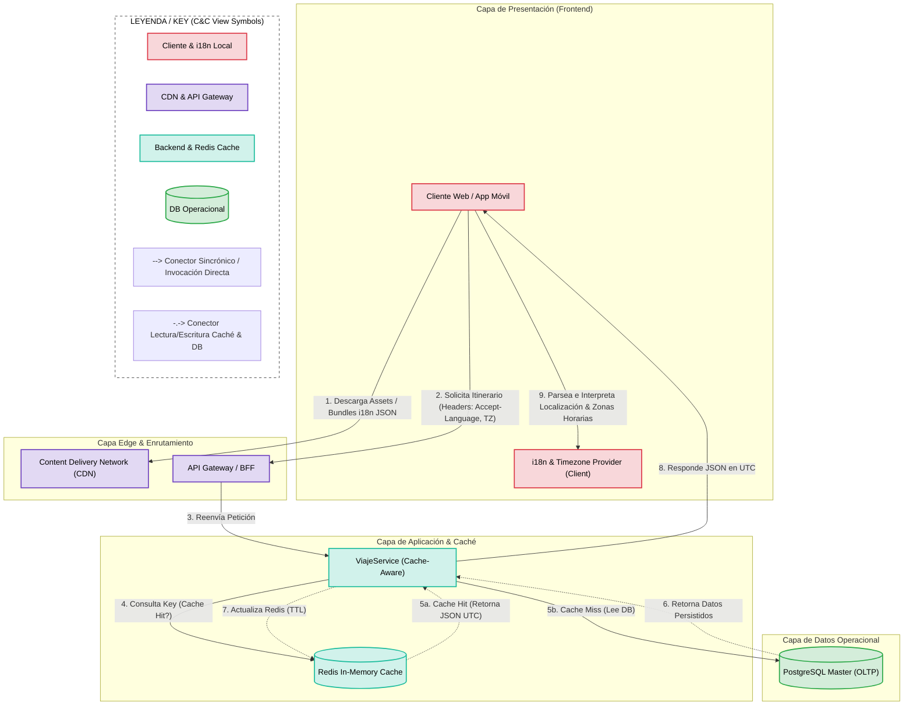

# Iteración 4: Internacionalización (i18n), Usabilidad y Optimización de Caché/Latencia

## Paso 1: Revisión de entradas

Se revisan las entradas disponibles al iniciar esta cuarta iteración:

* **Diseño existente (Resultado de las Iteraciones 1, 2 y 3):** Arquitectura Multi-Tier, desacoplamiento asincrónico por eventos mediante Message Broker, aislamiento con patrón ACL (`IAgenciaAdapter`), segregación OLTP/OLAP con réplica de lectura y pipeline ETL, seguridad con API Gateway, JWT, cifrado AES-256 (KMS) y topología de despliegue auto-escalable con Load Balancer.
* **Estado del Backlog de Drivers:**
  * **Completamente Abordados:** `CRN-01`, `CON-01`, `QA-01a / CRN-02`, `QA-03a,b / QA-05a,b`, `UC-01`, `CON-03`, `CON-02`, `UC-02`, `CRN-03 / UC-03`, `QA-04a,b,c,d`, `QA-02 / QA-07`.
  * **No Tratados / Pendientes para esta iteración:**
    * `QA-06`: **Usabilidad e Internacionalización (i18n):** Soporte multi-idioma, formato de fechas/monedas localizadas y gestión de zonas horarias heterogéneas.
    * `QA-01b, c`: **Performance, Latencia y Optimización de Red:** Estrategia de almacenamiento en caché distribuida y en el borde para consultas de itinerarios recurrentes y assets del frontend.
    *   `QA-03c y d` (Interoperabilidad con Redes Sociales y Agencia Preferida).

---

## Paso 2: Establecer el objetivo de la iteración seleccionando los drivers

**Objetivo de la iteración:** Diseñar el mecanismo de internacionalización y localización en la Capa de Presentación (Frontend/BFF), e instanciar una arquitectura de caché de dos niveles (CDN en el borde y almacenamiento en memoria mediante Redis) para minimizar la latencia de respuesta en la visualización de itinerarios y optimizar el rendimiento global del cliente.

**Drivers seleccionados para abordar en esta iteración:**
* **QA-06 — Usabilidad e Internacionalización (i18n):** Garantizar la adaptación dinámica de idiomas (español, inglés, etc.), la conversión e interpretación de husos horarios (UTC y offsets locales) para vuelos/reservas, y el formato regional de monedas/fechas en la capa de presentación.
* **QA-01b, c — Performance, Latencia y Caché:** Reducir los tiempos de respuesta en la carga del frontend y la consulta de itinerarios consolidados utilizando almacenamiento en caché en el borde (*Content Delivery Network - CDN*) y un almacén *In-Memory Cache* (Redis) en el lado del servidor.

---

## Paso 3: Elegir uno o más elementos del sistema a refinar

Dado que el núcleo backend, la seguridad y la persistencia ya fueron especificados en iteraciones anteriores, se seleccionan los siguientes elementos para refinamiento:

1. **Capa de Presentación (Frontend & BFF / API Gateway):** Refinamiento de la estructura modular del cliente Web/Móvil para integrar librerías e interfaces de internacionalización (i18n Provider, manejo de locales y zonas horarias).
2. **Capa de Almacenamiento e Intermediación de Caché (Redis & CDN):** Integración de una capa de caché en memoria (*Redis Cache Tier*) situada entre los servicios backend (`ViajeService`) y la base de datos transaccional (PostgreSQL OLTP), combinada con una red de distribución de contenido (*CDN*) para el tráfico estático.

---

## Paso 4: Elegir los conceptos de diseño que satisfacen los drivers seleccionados

A partir del catálogo de tácticas y patrones de arquitectura (revisando *Maintain Multiple Copies of Data / Caching*):

### 1. Patrón: Two-Level Caching (CDN Edge + In-Memory Cache)
**Táctica Asociada:** Maintain Multiple Copies of Data (Caching) / Reduce Computational Overhead.

- **Por qué elegimos esta opción:**
  Para satisfacer `QA-01b, c`, descargar de trabajo a la base de datos primaria `PostgreSQL OLTP` y minimizar la latencia del usuario final. La CDN sirve el *bundle* del frontend y recursos estáticos desde ubicaciones físicamente cercanas al usuario, mientras que Redis guarda en memoria las consultas frecuentes de itinerarios unificados (`Read-Through / Cache-Aside`).

| Opción Evaluada | Pros | Contras | Decisión |
| :--- | :--- | :--- | :--- |
| **Opción A: Cache Distribuido (Redis) + CDN** | - Invalida latencias de red y reduce drásticamente la carga sobre la DB. - Respuesta sub-100ms para itinerarios leídos frecuentemente. | - Requiere lógica de invalidación/TTL de caché para mantener consistencia. | **Seleccionada.** |
| **Opción B: Consultas directas a DB con índices** | - Garantiza consistencia estricta de datos. | - Mayor tiempo de respuesta y contención de recursos en picos de demanda. | *Descartada.* |

---

### 2. Patrón: Client-Side i18n with Normalized UTC Backend
**Táctica Asociada:** Separate Presentation from Core Logic / Encapsulate Locale Context.

- **Por qué elegimos esta opción:**
  Para abordar `QA-06`, se establece que el servidor y la base de datos persistan todas las marcas temporales en estándar **UTC ISO-8601**. La Capa de Presentación (Frontend) utiliza paquetes de i18n (recursos de traducción cargados bajo demanda) y módulos de tiempo/moneda para formatear fechas y monedas según la región del usuario. Los horarios se expresan en la **zona horaria del lugar de cada reserva** (`QA-06d`): cada reserva transporta, junto a sus instantes UTC, la zona IANA de su origen y, si termina en otro lugar (vuelos, trenes, autobuses), la de su destino. Así, un vuelo Buenos Aires → Madrid muestra la salida en hora de Buenos Aires y la llegada en hora de Madrid, sin importar desde dónde se consulte.

| Opción Evaluada | Pros | Contras | Decisión |
| :--- | :--- | :--- | :--- |
| **Opción A: i18n en Frontend + Backend en UTC** | - Desacopla la lógica de presentación del Core. - Facilita el caching de contenido (el JSON del backend es agnóstico del idioma). | - Mayor tamaño inicial o carga diferida de paquetes de idioma (*bundles*). | **Seleccionada.** |
| **Opción B: Formateo e i18n en el Backend** | - Menor cómputo en el cliente. | - Invalida la reutilización de respuestas en caché para usuarios con distintas preferencias de idioma. | *Descartada.* |

---

## Paso 5: Instanciar elementos arquitectónicos y asignar responsabilidades

1. **CDN (Edge Network):** Sirve los activos estáticos del Frontend (Single Page Application, estilos, archivos i18n JSON) y almacena en el borde respuestas públicas de la API.
2. **Frontend App (Web/Mobile) - i18n Module & Locale Provider:** Carga los archivos de traducción según la preferencia del usuario, gestiona el formateo regional (moneda, fechas) según el locale del usuario y, mediante el `DateTimeFormatter`, convierte cada marca UTC recibida del backend a la zona horaria del lugar de la reserva al que corresponde (origen para el inicio, destino para el fin).
3. **Redis In-Memory Cache:** Actúa como caché intermedia de lecturas (*Cache-Aside pattern*). Almacena representaciones JSON de los viajes e itinerarios consolidados de los usuarios para evitar re-consultar la base relacional PostgreSQL en cada navegación.
4. **ViajeService (Cache-Aware):** Gestiona la lógica de negocio consultando primero a Redis; si hay un *Cache Miss*, lee de la DB `PostgreSQL OLTP Primary` y puebla el caché. Ante actualizaciones (edición manual o ingesta de mails), invalida las claves asociadas en Redis.

---

## Paso 6: Definir Interfaces y Vistas Arquitectónicas

### Vista 1: Vista de Módulos (Estructura de Descomposición - i18n y Localización)
Esta vista organiza el código del frontend en paquetes y módulos con responsabilidades aisladas, garantizando que los componentes de UI estén desacoplados de textos planos y dependan de proveedores de localización.

```mermaid
graph TD
    classDef uiModule fill:#f8d7da,stroke:#dc3545,stroke-width:2px,color:#000000;
    classDef i18nCore fill:#e2d9f3,stroke:#6f42c1,stroke-width:2px,color:#000000;
    classDef resourceModule fill:#fff3cd,stroke:#ffc107,stroke-width:2px,color:#000000;
    classDef keyBox fill:#ffffff,stroke:#333333,stroke-width:1px,stroke-dasharray: 5 5,color:#000000;

    subgraph PresentationLayer ["Capa de Presentación (Frontend Modules)"]
        
        subgraph UIComponents ["Módulo de Componentes Visuales"]
            ItineraryView["ItineraryView / Pages"]:::uiModule
            Widgets["UI Widgets (Cards, Modals)"]:::uiModule
        end

        subgraph i18nModule ["Módulo Core de i18n & Localización"]
            I18nProvider["i18n Context / Provider"]:::i18nCore
            TranslatorService["Translation Engine"]:::i18nCore
            DateTimeFormatter["DateTime & Timezone Formatter"]:::i18nCore
            CurrencyFormatter["Currency & Number Formatter"]:::i18nCore
        end

        subgraph LocaleResources ["Módulo de Recursos Estáticos (Bundles)"]
            LangES["es.json (Español)"]:::resourceModule
            LangEN["en.json (Inglés)"]:::resourceModule
            LangPT["pt.json (Portugués)"]:::resourceModule
        end

    end

    UIComponents -->|"depends on / uses"| I18nProvider
    I18nProvider --> TranslatorService
    I18nProvider --> DateTimeFormatter
    I18nProvider --> CurrencyFormatter
    
    TranslatorService -.->|"loads on demand"| LocaleResources

    subgraph LeyendaModulos ["LEYENDA / VISTA DE MÓDULOS"]
        direction LR
        L1[Rojo: Componentes UI]:::uiModule
        L2[Púrpura: Servicios i18n Core]:::i18nCore
        L3[Amarillo: Recurso/Bundles Idioma]:::resourceModule
    end
    class LeyendaModulos keyBox;
```

### Vista 2: Vista C&C (Mecanismo de Caché y Entrega en el Borde)

Esta vista modela la interacción en tiempo de ejecución entre el cliente, la infraestructura de borde (CDN), el API Gateway, la capa de caché distribuida en memoria (Redis) y los servicios del backend, garantizando tiempos de respuesta de baja latencia y reduciendo la carga de lectura sobre la base de datos operacional.

## Paso 7: Evaluar el diseño actual y revisar el backlog de drivers

**Evaluación de la Iteración 4 respecto a los objetivos del Paso 2:**
El diseño desarrollado en esta cuarta iteración resolvió de forma completa los requisitos de rendimiento en el frontend, latencia de red e internacionalización. En primer lugar, la **Vista de Módulos (Estructura de Descomposición)** permitió estructurar el cliente para desacoplar completamente las cadenas de texto visuales de la lógica Core, delegando el formateo regional (monedas, fechas y zonas horarias) a proveedores cliente aislados (`QA-06`). En segundo lugar, la **Vista C&C** instanció la infraestructura de borde (CDN) para la entrega estática de activos/bundles e integró la capa de almacenamiento en memoria (*Redis In-Memory Cache*) mediante el patrón *Cache-Aside*, reduciendo la latencia de consulta de itinerarios a rangos sub-100ms y eliminando la contención de lecturas sobre la base operacional `PostgreSQL OLTP` (`QA-01b, c`).

**Estado consolidado del proyecto:**
Con los drivers tratados en esta iteración se cubre la mayor parte del backlog de requerimientos funcionales, escenarios de atributos de calidad y restricciones. Al revisar el backlog completo contra el documento de drivers se detectaron escenarios que todavía no tenían una decisión de diseño asociada (`QA-03c`, `QA-03d`, `QA-06c`) y uno cubierto solo en parte (`QA-04b`).

A continuación, se presenta la tabla con el estado del backlog tras concluir la Iteración 4:

### Estado actualizado del Backlog de Drivers (Fin de Iteración 4)

| ID Driver | Descripción / Atributo | Estado Actual | Comentarios / Resolución |
| :--- | :--- | :--- | :--- |
| **CRN-01** | Estructura general greenfield | Completamente Abordado | Resuelto en Iteración 1 (Multi-Tier, MVC/API). |
| **CON-01** | Soporte multiplataforma | Completamente Abordado | Resuelto en Iteración 1 (BFF / API Gateway). |
| **QA-01a / CRN-02**| Performance Asincrónica (< 5m) | Completamente Abordado | Resuelto en Iteración 2 mediante Message Broker y Pub-Sub. |
| **QA-03a,b / QA-05a,b**| Interoperabilidad y Mantenibilidad | Completamente Abordado | Resuelto en Iteración 2 mediante Anti-Corruption Layer e Interfaces (`IAgenciaAdapter`). |
| **UC-01** | Unificación automática (Mails) | Completamente Abordado | Resuelto en Iteración 2 mediante ingesta asincrónica (Listeners/Workers). |
| **CON-03** | Spec-Driven Development | Completamente Abordado | Resuelto en Iteración 2 mediante especificación de contratos e interfaces. |
| **CON-02** | Protocolos de correo OAuth2/IMAP | Completamente Abordado | Resuelto en Iteración 3 mediante Auth Gateway y KMS. |
| **UC-02** | Gestión manual de viaje | Completamente Abordado | Resuelto en Iteración 3 con soporte de persistencia relacional PostgreSQL. |
| **CRN-03 / UC-03** | Segregación OLAP/OLTP | Completamente Abordado | Resuelto en Iteración 3 mediante Read Replicas y Pipeline ETL. |
| **QA-04a,c,d** | Seguridad y Privacidad | Completamente Abordado | Resuelto en Iteración 3 con Auth Manager, JWT y Cifrado AES-256. |
| **QA-04b** | Visualización de itinerarios compartidos | Parcialmente Abordado | La Iteración 3 garantiza autenticación (JWT), pero no se modeló el mecanismo de compartición ni la lista de personas designadas. Candidato para Iteración 5. |
| **QA-02 / QA-07** | Redundancia y Escalado (Picos) | Completamente Abordado | Resuelto en Iteración 3 con Topología de Despliegue en la Nube y ASG. |
| **QA-01b, c** | Optimizaciones de Red y Front | Completamente Abordado | Resuelto en Iteración 4 mediante CDN Edge y Redis In-Memory Cache. |
| **QA-06a,b,d** | Usabilidad e Internacionalización | Completamente Abordado | Resuelto en Iteración 4 mediante arquitectura de Módulos i18n en cliente y UTC backend. |
| **QA-06c** | Resolución de problemas durante una disrupción | No Tratado | Depende de la integración con la agencia preferida (`QA-03d`). Candidato para Iteración 5. |
| **QA-03c** | Interoperabilidad con Redes Sociales | No Tratado | Presente en el Diagrama de Contexto (Iteración 1), pero sin componentes ni decisiones asociadas. Candidato para Iteración 5. |
| **QA-03d** | Interoperabilidad con Agencia Preferida | No Tratado | Presente en el Diagrama de Contexto (Iteración 1), pero sin componentes ni decisiones asociadas. Candidato para Iteración 5. |

**Conclusión de la Iteración 4:**
Con esta iteración quedan abordados los drivers de mayor prioridad e impacto arquitectónico (estructura, asincronía, integración con proveedores, seguridad, datos, despliegue, caché e internacionalización). Sin embargo, al revisar el backlog se detectó que los escenarios de interoperabilidad con **Redes Sociales (`QA-03c`)** y con la **Agencia Preferida (`QA-03d`)** no fueron tratados, que la compartición de itinerarios con personas designadas (`QA-04b`) quedó solo parcialmente cubierta, y que la resolución de problemas durante una disrupción (`QA-06c`) depende de la integración con la agencia. Estos drivers se abordan en la **Iteración 5**.

