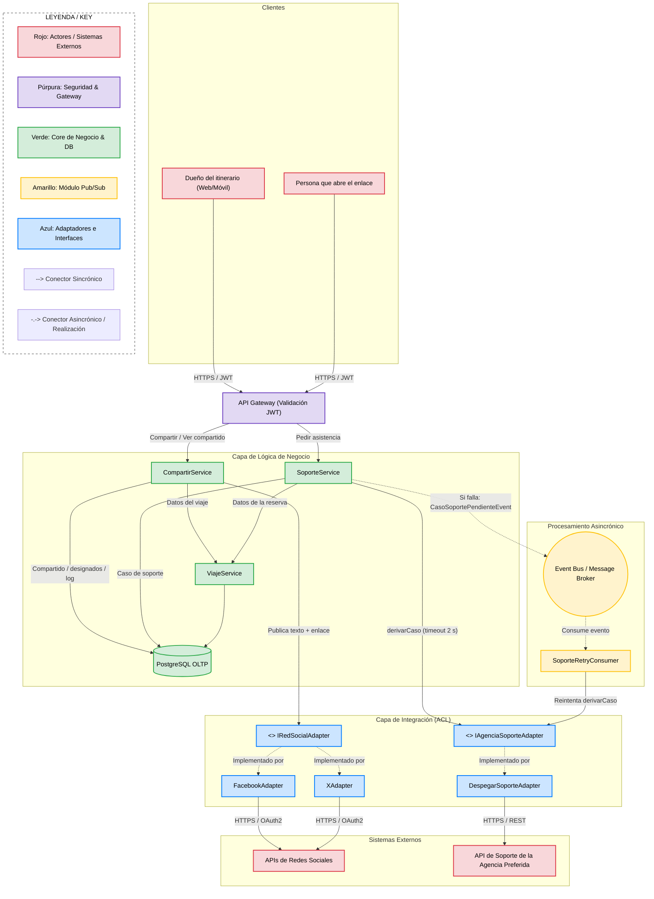
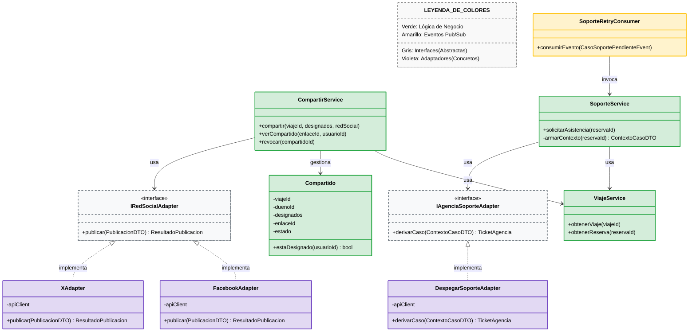
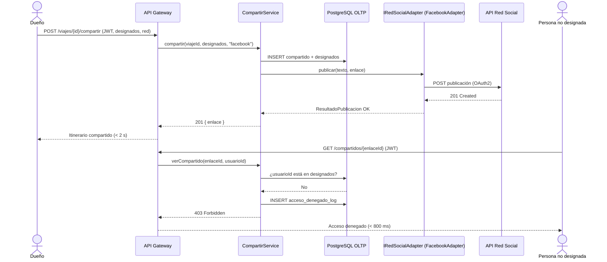
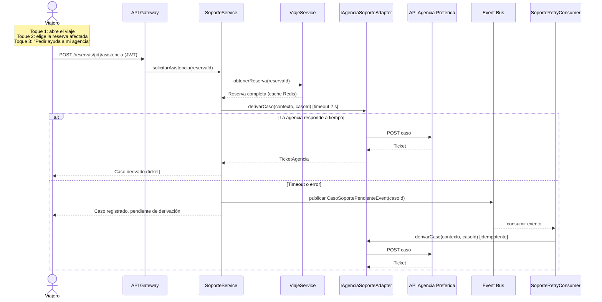

# Iteración 5: Interoperabilidad con Redes Sociales y Agencia Preferida, y Compartición Segura de Itinerarios

## Paso 1: Revisión de entradas

Se revisan las entradas disponibles al iniciar esta quinta iteración:

* **Diseño existente (Resultado de las Iteraciones 1 a 4):** Arquitectura Multi-Tier en 5 capas lógicas, desacoplamiento asincrónico mediante Message Broker (Pub-Sub), aislamiento de proveedores externos con Anti-Corruption Layer (`IAgenciaAdapter`), segregación OLTP/OLAP con réplica de lectura y pipeline ETL, seguridad perimetral con API Gateway, JWT y cifrado AES-256 (KMS), topología auto-escalable, caché de dos niveles (CDN + Redis) e internacionalización en el cliente con backend neutro en UTC.
* **Estado del Backlog de Drivers:**
  * **Completamente Abordados:** `CRN-01`, `CON-01`, `QA-01a / CRN-02`, `QA-03a,b / QA-05a,b`, `UC-01`, `CON-03`, `CON-02`, `UC-02`, `CRN-03 / UC-03`, `QA-04a,c,d`, `QA-02 / QA-07`, `QA-01b,c`, `QA-06a,b,d`.
  * **Parcialmente Abordados:**
    * `QA-04b` (Itinerarios compartidos; existe autenticación JWT pero no un mecanismo de compartición con personas designadas).
  * **No Tratados:**
    * `QA-03c` (Interoperabilidad con Redes Sociales).
    * `QA-03d` (Interoperabilidad con la Agencia Preferida para resolución de problemas).
    * `QA-06c` (Resolución de problemas durante una disrupción masiva).

---

## Paso 2: Establecer el objetivo de la iteración seleccionando los drivers

**Objetivo de la iteración:** Extender la Capa de Integración Externa para interoperar con redes sociales y con la agencia de viajes preferida del usuario, y diseñar en la Capa de Lógica de Negocio el mecanismo de compartición de itinerarios que garantice que solo las personas designadas por el dueño puedan visualizarlos.

**Drivers seleccionados para abordar en esta iteración:**
* **QA-03c — Interoperabilidad con Redes Sociales:** Compartir el itinerario activo adaptando los datos al formato de cada red social, con éxito en menos de 2 segundos en el 99% de las solicitudes.
* **QA-03d — Interoperabilidad con la Agencia Preferida:** Transferir los datos del itinerario afectado a la agencia del usuario en menos de 2 segundos.
* **QA-04b — Seguridad en itinerarios compartidos:** 0 accesos de personas no designadas; la denegación se produce en menos de 800 ms y queda registrada.
* **QA-06c — Resolución de problemas durante una disrupción:** Contacto con la agencia en un máximo de 3 toques, transfiriendo el 100% de los datos de la reserva sin reingreso manual, con carga de interfaz menor a 3 segundos durante el pico de tráfico.

Adicionalmente, el diseño debe preservar **QA-05b** (un cambio en la API de un proveedor se localiza en un único adaptador).

---

## Paso 3: Elegir uno o más elementos del sistema a refinar

Se seleccionan los siguientes elementos para realizar un refinamiento interno (*zoom-in*):

1. **Capa de Integración Externa:** Se extiende el *Anti-Corruption Layer* definido en la Iteración 2 para incorporar dos nuevas familias de sistemas externos: redes sociales y agencias de soporte.
2. **Capa de Lógica de Negocio:** Se incorporan los servicios de dominio responsables de la compartición de itinerarios y de la derivación de problemas a la agencia, junto al `ViajeService` existente.
3. **Control de acceso a itinerarios (transversal):** Se refina la autorización establecida en la Iteración 3 (JWT en el API Gateway) para modelar el permiso de visualización por persona designada.

---

## Paso 4: Elegir los conceptos de diseño que satisfacen los drivers seleccionados

### 1. Patrón: Anti-Corruption Layer con Interfaces Segregadas
**Táctica Asociada:** *Encapsulate / Use an Intermediary / Tailor Interface* (Modificabilidad e Interoperabilidad).

- **Por qué elegimos esta opción:**
  Las redes sociales (Facebook, X) y las agencias de soporte tienen APIs heterogéneas y cambiantes, igual que los proveedores de reservas tratados en la Iteración 2. Se reutiliza el mismo patrón ACL, pero con **contratos separados por responsabilidad**: `IAgenciaAdapter` sigue siendo el contrato para *obtener reservas*, `IRedSocialAdapter` es el contrato para *publicar* y `IAgenciaSoporteAdapter` es el contrato para *derivar un caso*. No toda agencia que provee reservas ofrece soporte, ni viceversa; cuando una agencia ofrece ambas cosas, su adaptador concreto implementa ambos contratos.
- **Drivers que aborda:** `QA-03c`, `QA-03d`, `QA-05b`.

| Opción Evaluada | Pros | Contras | Decisión |
| :--- | :--- | :--- | :--- |
| **Opción A: ACL con interfaces segregadas (`IRedSocialAdapter`, `IAgenciaSoporteAdapter`)** | - Cada contrato es pequeño y cohesivo (principio de segregación de interfaces). - Un cambio en la API de una red social afecta un solo adaptador (**QA-05b**). - Reutiliza un patrón ya conocido por el equipo. | - Aumenta la cantidad de interfaces y clases en la Capa de Integración.  **Mitigación de Trade-offs:** Las interfaces se definen con DTOs neutros mínimos (`PublicacionDTO`, `ContextoCasoDTO`) y se documentan como contratos (Spec-driven), lo que mantiene acotado el costo de agregar adaptadores. | **Seleccionada.** |
| **Opción B: Ampliar `IAgenciaAdapter` con operaciones de publicación y soporte** | - Menor cantidad de interfaces. - Un único punto de integración para "lo externo". | - Obliga a adaptadores que no soportan esas operaciones a implementarlas vacías. - Mezcla responsabilidades y amplía el impacto de los cambios, en contra de **QA-05b**. | *Descartada.* |

---

### 2. Patrón: Compartición por Enlace con Lista de Personas Designadas
**Táctica Asociada:** *Authorize Actors / Limit Exposure / Audit* (Seguridad).

- **Por qué elegimos esta opción:**
  Compartir en una red social expone el contenido a cualquiera que vea la publicación, lo que contradice `QA-04b`. Por eso **a la red social nunca se envía el itinerario**, solo un texto y un enlace a un recurso `Compartido` que controla Trotamundos. El `Compartido` registra el viaje, su dueño y la lista de personas designadas. Al abrir el enlace, la persona debe autenticarse (JWT, Iteración 3) y el `CompartirService` verifica que esté en la lista; si no lo está, se deniega el acceso y se registra el intento.
- **Drivers que aborda:** `QA-04b`, `QA-03c`.

| Opción Evaluada | Pros | Contras | Decisión |
| :--- | :--- | :--- | :--- |
| **Opción A: Enlace a recurso `Compartido` con lista de designados y autenticación obligatoria** | - Garantiza 0 accesos de personas no designadas (**QA-04b**). - El dueño puede revocar o modificar la lista en cualquier momento sin tocar la publicación. - La publicación en la red es liviana (texto + enlace), lo que ayuda a cumplir los 2 s de **QA-03c**. | - La persona designada debe tener cuenta en Trotamundos para ver el itinerario.  **Mitigación de Trade-offs:** La verificación es una consulta por clave (`compartidoId`, `usuarioId`) cacheable en Redis (ADR-007), por lo que la denegación se resuelve muy por debajo de los 800 ms. El alta de una cuenta para la persona invitada se ofrece desde el mismo enlace. | **Seleccionada.** |
| **Opción B: Publicar el contenido del itinerario o un enlace público sin autenticación** | - Experiencia más directa: cualquiera ve el viaje sin registrarse. - Implementación más simple. | - Cualquier persona con acceso a la publicación ve los datos personales del viaje. - Incumple **QA-04b**. | *Descartada.* |

---

### 3. Táctica: Timeout con Reintento Asincrónico para la Derivación a la Agencia
**Táctica Asociada:** *Timeout / Retry / Degradation* (Disponibilidad).

- **Por qué elegimos esta opción:**
  `QA-06c` ocurre justamente durante disrupciones masivas, cuando las agencias externas están más saturadas. El `SoporteService` invoca a la agencia de forma sincrónica a través del adaptador con un **timeout de 2 segundos** (`QA-03d`). Si la agencia no responde a tiempo o falla, el caso no se pierde: se publica un evento `CasoSoportePendienteEvent` en el **Event Bus ya existente** (ADR-003) y un consumidor en segundo plano (`SoporteRetryConsumer`) lo reintenta. Al usuario se le informa de inmediato que su caso quedó registrado.
- **Drivers que aborda:** `QA-03d`, `QA-06c`, `QA-02`.

| Opción Evaluada | Pros | Contras | Decisión |
| :--- | :--- | :--- | :--- |
| **Opción A: Llamada sincrónica con timeout + reintento por el Event Bus** | - En el caso normal, la transferencia se confirma en menos de 2 s (**QA-03d**). - Ante caídas o saturación de la agencia, el caso se conserva y se reintenta (**QA-02**). - Reutiliza el broker y los workers auto-escalables (ADR-003, ADR-006), sin infraestructura nueva. | - Durante una caída de la agencia, la confirmación al usuario es diferida. - Los reintentos pueden duplicar un caso si la agencia lo recibió pero no respondió.  **Mitigación de Trade-offs:** Cada caso lleva un identificador único (`casoId`) que se envía a la agencia como clave de idempotencia. La interfaz muestra el estado del caso (pendiente / derivado). | **Seleccionada.** |
| **Opción B: Llamada sincrónica pura sin reintento** | - Implementación más simple. | - Si la agencia está caída o saturada durante la disrupción, el usuario recibe un error y debe reintentar manualmente. - Incumple **QA-06c** en el ambiente de pico. | *Descartada.* |

---

## Paso 5: Instanciar elementos arquitectónicos y asignar responsabilidades

### 1. Capa de Lógica de Negocio
* **CompartirService:** Crea, modifica y revoca recursos `Compartido`, verifica la autorización de visualización y registra los intentos denegados. Para publicar en redes sociales delega exclusivamente en `IRedSocialAdapter`.
* **Compartido (entidad de dominio):** Viaje compartido, dueño, lista de personas designadas, identificador no adivinable del enlace y estado (activo / revocado).
* **SoporteService:** Arma el `ContextoCasoDTO` a partir de la reserva afectada, con todos sus datos obtenidos del `ViajeService` sin reingreso manual (`QA-06c`), y lo deriva mediante `IAgenciaSoporteAdapter`, aplicando el timeout y, si hace falta, publicando el evento de reintento.
* **ViajeService (existente):** Provee los datos del viaje y de la reserva a ambos servicios. No conoce redes sociales ni agencias de soporte.

### 2. Capa de Integración Externa (extensión del ACL)
* **IRedSocialAdapter:** Contrato `publicar(PublicacionDTO): ResultadoPublicacion`.
* **FacebookAdapter / XAdapter:** Implementaciones concretas. Adaptan texto y enlace al formato y a la autenticación (OAuth2) de cada red.
* **IAgenciaSoporteAdapter:** Contrato `derivarCaso(ContextoCasoDTO): TicketAgencia`.
* **DespegarSoporteAdapter:** Implementación concreta para la agencia preferida. Traduce el contexto al formato de la API de soporte de la agencia.
* Igual que en la Iteración 2, **ningún adaptador accede a la base de datos**.

### 3. Módulo de Procesamiento Asincrónico (extensión)
* **CasoSoportePendienteEvent:** Nuevo tipo de evento publicado en el Event Bus existente.
* **SoporteRetryConsumer:** Subscriber que reintenta la derivación con backoff. Se despliega en el mismo Worker Auto-Scaling Group (ADR-006).

### 4. Capa de Datos
* **PostgreSQL OLTP:** Nuevas tablas `compartido`, `compartido_designado`, `caso_soporte` y `acceso_denegado_log`.

---

## Paso 6: Definir Interfaces y Vistas Arquitectónicas

### Vista 1: Vista C&C (Compartición e Integración con Redes Sociales y Agencia)
Esta vista modela, en tiempo de ejecución, cómo las nuevas solicitudes ingresan por el API Gateway, se resuelven en los servicios de dominio y salen hacia los sistemas externos únicamente a través de los adaptadores.

#### Leyenda y Explicación de la Vista 1 (C&C)
* **API Gateway:** Todas las solicitudes, incluida la apertura de un enlace compartido, requieren un JWT válido (ADR-005).
* **CompartirService → IRedSocialAdapter:** A la red social solo viaja un texto y el enlace al recurso `Compartido`, nunca los datos del itinerario.
* **SoporteService → IAgenciaSoporteAdapter:** Derivación sincrónica con timeout de 2 s. Si falla, el caso se publica en el Event Bus y el `SoporteRetryConsumer` lo reintenta.
* **Adaptadores:** Igual que en la Iteración 2, ningún adaptador accede a la base de datos.

---

### Vista 2: Vista de Módulos (Contratos e Implementaciones)
Esta vista representa la organización estática del código y las relaciones de dependencia (*allowed-to-use*) entre los servicios de dominio y los nuevos contratos de integración.

#### Leyenda y Explicación de la Vista 2 (Módulos)
* **CompartirService / SoporteService:** Solo dependen de contratos abstractos; desconocen las redes sociales y agencias concretas.
* **IAgenciaAdapter (Iteración 2) no se modifica:** Los nuevos contratos se agregan junto a él (Opción A del Paso 4.1).
* **Compartido:** Encapsula la regla de autorización `estaDesignado(usuarioId)`.

---

### Vista 3: Diagrama de Secuencia — Compartir un itinerario y acceso denegado
Muestra el escenario de `QA-03c` (publicación en menos de 2 s) seguido del escenario de `QA-04b` (una persona no designada intenta abrir el enlace).

### Vista 4: Diagrama de Secuencia — Pedir asistencia a la agencia durante una disrupción
Muestra el escenario de `QA-06c`/`QA-03d`, incluyendo el camino alternativo cuando la agencia no responde dentro del timeout.

---

## Paso 7: Evaluar el diseño actual y revisar el backlog de drivers

**Evaluación de la Iteración 5 respecto a los objetivos del Paso 2:**
La extensión del *Anti-Corruption Layer* con interfaces segregadas (`IRedSocialAdapter`, `IAgenciaSoporteAdapter`) resolvió la interoperabilidad con redes sociales y con la agencia preferida (`QA-03c`, `QA-03d`) sin modificar el contrato `IAgenciaAdapter` ni el `ViajeService`, preservando `QA-05b`. La compartición mediante un recurso `Compartido` con lista de personas designadas permite publicar en redes sociales sin exponer datos personales y garantiza que solo las personas designadas visualicen el itinerario, registrando los intentos denegados (`QA-04b`). Por último, la combinación de timeout y reintento asincrónico sobre el Event Bus existente permite derivar el caso a la agencia en un máximo de 3 toques y con el contexto completo, incluso durante un pico de disrupción (`QA-06c`).

**Qué faltó o quedó parcialmente cubierto:**
* El **módulo funcional avanzado** (Opción A o B), requerido para la segunda entrega, todavía no fue diseñado. La integración con la agencia definida en esta iteración (`IAgenciaSoporteAdapter`) queda disponible para ser reutilizada si se elige el asistente virtual (Opción B).

### Estado actualizado del Backlog de Drivers (Fin de Iteración 5)

| ID Driver | Descripción / Atributo | Estado Actual | Comentarios / Resolución |
| :--- | :--- | :--- | :--- |
| **CRN-01** | Estructura general greenfield | Completamente Abordado | Resuelto en Iteración 1 (Multi-Tier, MVC/API). |
| **CON-01** | Soporte multiplataforma | Completamente Abordado | Resuelto en Iteración 1 (BFF / API Gateway). |
| **QA-01a / CRN-02**| Performance Asincrónica (< 5m) | Completamente Abordado | Resuelto en Iteración 2 mediante Message Broker y Pub-Sub. |
| **QA-03a,b / QA-05a,b**| Interoperabilidad y Mantenibilidad | Completamente Abordado | Resuelto en Iteración 2 mediante Anti-Corruption Layer e Interfaces (`IAgenciaAdapter`). |
| **UC-01** | Unificación automática (Mails) | Completamente Abordado | Resuelto en Iteración 2 mediante ingesta asincrónica (Listeners/Workers). |
| **CON-03** | Spec-Driven Development | Completamente Abordado | Resuelto en Iteración 2 mediante especificación de contratos e interfaces. |
| **CON-02** | Protocolos de correo OAuth2/IMAP | Completamente Abordado | Resuelto en Iteración 3 mediante Auth Gateway y KMS. |
| **UC-02** | Gestión manual de viaje | Completamente Abordado | Resuelto en Iteración 3 con soporte de persistencia relacional PostgreSQL. |
| **CRN-03 / UC-03** | Segregación OLAP/OLTP | Completamente Abordado | Resuelto en Iteración 3 mediante Read Replicas y Pipeline ETL. |
| **QA-04a,c,d** | Seguridad y Privacidad | Completamente Abordado | Resuelto en Iteración 3 con Auth Manager, JWT y Cifrado AES-256. |
| **QA-04b** | Visualización de itinerarios compartidos | Completamente Abordado | Resuelto en Iteración 5 mediante recurso `Compartido` con lista de designados (ADR-010). |
| **QA-02 / QA-07** | Redundancia y Escalado (Picos) | Completamente Abordado | Resuelto en Iteración 3 con Topología de Despliegue en la Nube y ASG. |
| **QA-01b, c** | Optimizaciones de Red y Front | Completamente Abordado | Resuelto en Iteración 4 mediante CDN Edge y Redis In-Memory Cache. |
| **QA-06a,b,d** | Usabilidad e Internacionalización | Completamente Abordado | Resuelto en Iteración 4 mediante arquitectura de Módulos i18n en cliente y UTC backend. |
| **QA-03c** | Interoperabilidad con Redes Sociales | Completamente Abordado | Resuelto en Iteración 5 mediante `IRedSocialAdapter` (ADR-009). |
| **QA-03d** | Interoperabilidad con Agencia Preferida | Completamente Abordado | Resuelto en Iteración 5 mediante `IAgenciaSoporteAdapter` con timeout y reintento (ADR-009). |
| **QA-06c** | Resolución de problemas durante una disrupción | Completamente Abordado | Resuelto en Iteración 5 mediante `SoporteService` (contexto completo, 3 toques) y reintento asincrónico. |
| **Módulo avanzado** | Opción A o B (2da entrega) | No Tratado | Se abordará en una iteración posterior. |

**Conclusión de la Iteración 5:**
Con esta iteración quedan abordados todos los escenarios de atributos de calidad, casos de uso y restricciones del documento de drivers. La arquitectura queda lista para la implementación del prototipo; el módulo funcional avanzado de la segunda entrega se diseñará en una próxima iteración, reutilizando la Capa de Integración y el Event Bus existentes.
