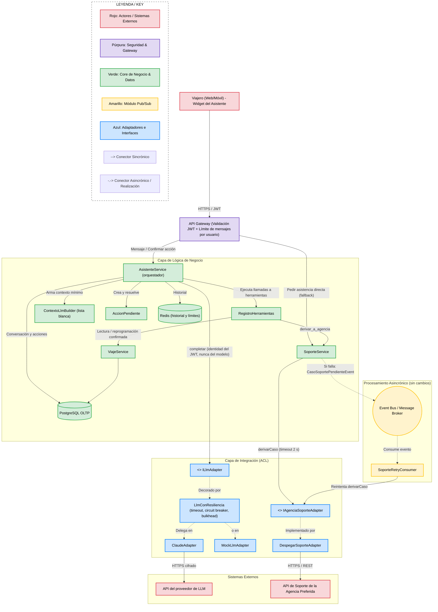
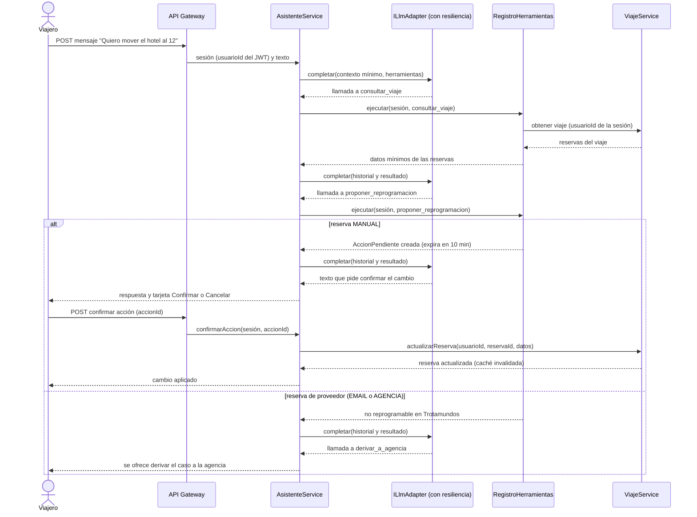
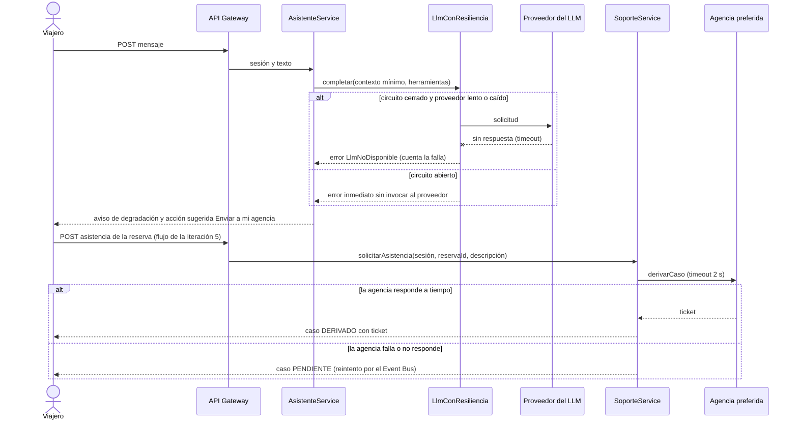

# Iteración 6: Módulo Avanzado (Opción B) — Asistente Virtual como Primer Nivel de Soporte

## Paso 1: Revisión de entradas

Se revisan las entradas disponibles al iniciar esta sexta iteración:

* **Diseño existente (Resultado de las Iteraciones 1 a 5):** Arquitectura Multi-Tier en 5 capas lógicas, desacoplamiento asincrónico mediante Message Broker (Pub-Sub), *Anti-Corruption Layer* con interfaces segregadas (`IAgenciaAdapter`, `IRedSocialAdapter`, `IAgenciaSoporteAdapter`), segregación OLTP/OLAP con réplica de lectura y pipeline ETL, seguridad perimetral con API Gateway, JWT y cifrado AES-256 (KMS), topología auto-escalable con nodos *stateless*, caché de dos niveles (CDN + Redis), internacionalización en el cliente con backend neutro en UTC, compartición por enlace con lista de designados y derivación a la agencia con timeout y reintento asincrónico.
* **Módulo avanzado seleccionado:** **Opción B — Asistente Virtual (Chatbot)**, como primer nivel de soporte interactivo para gestionar reprogramaciones, consultas de estado y problemas menores, delegando a la agencia preferida únicamente los casos complejos (`UC-04`). Se elige la Opción B porque la Iteración 5 ya dejó resuelta la derivación a la agencia (`SoporteService`, `IAgenciaSoporteAdapter`, reintento por el Event Bus), que el asistente reutiliza como mecanismo de escalamiento.
* **Estado del Backlog de Drivers:**
  * **Completamente Abordados:** todos los drivers de las Iteraciones 1 a 5 (ver tabla del Paso 7 de la Iteración 5).
  * **Nuevos, No Tratados:** `UC-04`, `QA-01d`, `QA-02b`, `QA-04e`, `QA-04f`, `QA-05c`, `QA-06e`, `QA-07c`, `CON-05` y `CRN-05` (incorporados en `docs/drivers.md`).

---

## Paso 2: Establecer el objetivo de la iteración seleccionando los drivers

**Objetivo de la iteración:** Diseñar el asistente virtual como una capa de conversación sobre los servicios de dominio existentes, de modo que (a) acceda a los datos y los modifique solo con la identidad y la autorización del usuario, (b) integre un LLM de terceros sin acoplar el núcleo a ningún proveedor, (c) se degrade hacia la derivación directa a la agencia cuando el LLM falle o se sature, y (d) no comprometa los atributos de calidad ya logrados para el resto de la plataforma.

**Drivers seleccionados para abordar en esta iteración:**
* **UC-04 — Asistente Virtual:** funcionalidad primaria de la iteración.
* **QA-04e — Aislamiento y autorización de las acciones del asistente:** 0 accesos a datos ajenos y 0 modificaciones sin confirmación explícita del dueño.
* **QA-04f — Datos enviados al proveedor del LLM:** solo el contexto mínimo, cifrado en tránsito, sin credenciales.
* **QA-02b — Falla o saturación del proveedor del LLM:** respuesta o aviso de degradación en ≤ 12 s (< 1 s con falla ya detectada), con derivación a la agencia siempre disponible.
* **QA-05c — Cambio de proveedor del LLM o nueva capacidad:** cambio localizado en un único módulo (< 2 días-persona); nueva herramienta en < 1 día-persona sin tocar el ciclo de conversación.
* **QA-06e — Escalamiento a la agencia desde el asistente:** ≤ 3 toques, 100% de los datos de la reserva sin reingreso.
* **QA-01d — Latencia del turno de conversación:** 95% de los turnos en < 8 s; operaciones sin LLM en < 800 ms.
* **QA-07c — Picos de conversaciones por disrupciones:** el asistente no degrada al resto de la API (99% < 800 ms).

**Restricción y preocupación consideradas:** `CON-05` (LLM como servicio externo) y `CRN-05` (orquestación segura de un agente conversacional).

Adicionalmente, el diseño debe preservar `QA-05b` (un cambio en la API de un proveedor se localiza en un único adaptador), `QA-06c` (3 toques hacia la agencia) y `QA-06d` (el asistente responde en el idioma del usuario y las fechas respetan la zona horaria de cada reserva).

---

## Paso 3: Elegir uno o más elementos del sistema a refinar

Se seleccionan los siguientes elementos para realizar un refinamiento interno (*zoom-in*):

1. **Capa de Lógica de Negocio:** se incorporan el `AsistenteService` (orquestador de la conversación), el Registro de Herramientas, la entidad `AccionPendiente` y el constructor de contexto para el LLM, junto a los servicios existentes (`ViajeService`, `SoporteService`).
2. **Capa de Integración Externa:** se extiende el *Anti-Corruption Layer* con un nuevo contrato, `ILlmAdapter`, para el proveedor del modelo de lenguaje.
3. **API Gateway:** se agregan las rutas del asistente y un límite de mensajes por usuario (*rate limiting*), además de la validación JWT ya existente (ADR-005).
4. **Capa de Presentación (refinamiento menor):** widget de chat, tarjeta de confirmación de acciones y acceso permanente al botón de derivación a la agencia.

La Capa de Datos solo recibe tablas nuevas; el Procesamiento Asincrónico, el despliegue y la analítica **no se modifican**.

---

## Paso 4: Elegir los conceptos de diseño que satisfacen los drivers seleccionados

### 1. Patrón: Anti-Corruption Layer con Adapter para el LLM (`ILlmAdapter`)
**Táctica Asociada:** *Use an Intermediary / Encapsulate / Tailor Interface* (Modificabilidad e Interoperabilidad).

- **Por qué elegimos esta opción:**
  Los proveedores de LLM tienen APIs, formatos de herramientas y modelos de autenticación heterogéneos y cambian con rapidez, igual que los proveedores de reservas (Iteración 2) o de redes sociales (Iteración 5). Se reutiliza el patrón ACL con un contrato nuevo y cohesivo, `ILlmAdapter.completar(...)`, que trabaja con DTOs neutros (mensajes, definiciones de herramientas, respuesta con texto o llamadas a herramientas). El `AsistenteService` solo conoce el contrato. Se prevén dos implementaciones: `ClaudeAdapter` (proveedor real) y `MockLlmAdapter` (simulación determinística para desarrollo, pruebas y demostración sin conexión), seleccionadas en la raíz de composición como ya se hace con los demás adaptadores.
- **Drivers que aborda:** `QA-05c`, `CON-05`, `QA-04f` (el adaptador es el único punto por donde sale información hacia el proveedor).

| Opción Evaluada | Pros | Contras | Decisión |
| :--- | :--- | :--- | :--- |
| **Opción A: Contrato propio `ILlmAdapter` con DTOs neutros** | - Cambiar de proveedor o modelo afecta un único módulo (**QA-05c**). - Permite un adaptador simulado: pruebas determinísticas y demo sin conexión. - Coherente con el patrón ACL ya conocido por el equipo y con Spec-driven (contrato explícito). | - Los DTOs neutros deben cubrir el mínimo común de los proveedores; capacidades específicas de uno no se aprovechan.  **Mitigación de Trade-offs:** El contrato se limita a lo que el asistente necesita (texto y llamadas a herramientas) y se documenta como contrato. | **Seleccionada.** |
| **Opción B: Usar el SDK del proveedor directamente desde `AsistenteService`** | - Menos código inicial. - Acceso inmediato a todas las capacidades del proveedor. | - Acopla el núcleo a un proveedor: cambiarlo implica reescribir el servicio (**QA-05c**). - Dificulta las pruebas sin red y la demostración de la degradación. | *Descartada.* |
| **Opción C: Framework de orquestación de agentes de terceros** | - Provee abstracciones listas (memoria, cadenas, herramientas). | - Dependencia pesada que oculta el flujo de control y complica la trazabilidad entre ADR, contrato y código. - Agrega superficie de actualización y de seguridad a mantener. | *Descartada.* |

---

### 2. Patrón: Tool Calling sobre Servicios de Dominio con Identidad del JWT y Contexto Mínimo
**Táctica Asociada:** *Authorize Actors / Limit Exposure / Validate Input / Limit Access* (Seguridad) y *Defer Binding* (Modificabilidad).

- **Por qué elegimos esta opción:**
  El asistente no accede a la base de datos ni a APIs internas: solo puede invocar **herramientas** registradas en un `RegistroHerramientas`, cada una definida por su nombre, su esquema de argumentos (JSON Schema) y su tipo (lectura, propuesta de escritura o escalamiento). Cada herramienta delega en un servicio de dominio existente (`ViajeService`, `SoporteService`). Tres reglas se aplican siempre:
  1. **Identidad:** el `usuarioId` proviene exclusivamente de la sesión validada por el API Gateway (JWT); ningún argumento generado por el modelo puede cambiarlo. Una referencia a un recurso ajeno produce el mismo resultado que un recurso inexistente.
  2. **Validación:** los argumentos de cada llamada a herramienta se validan contra su esquema antes de ejecutarse; las fechas se reciben en hora local de la reserva y el backend las convierte a UTC (ADR-008), de modo que el modelo no hace aritmética de zonas horarias.
  3. **Contexto mínimo:** un `ContextoLlmBuilder` construye lo que viaja al LLM a partir de una **lista blanca de campos** (tipo, título, proveedor, código de confirmación, estado, fechas y zona horaria, destino, nombre de pila). Nunca se envían tokens de correo, credenciales, contenidos de correos ni datos de otras personas. Los textos que provienen de fuentes externas (por ejemplo, el título de una reserva importada de un correo) se tratan como **datos no confiables**: se entregan al modelo delimitados como datos, y no pueden ejecutar acciones por sí mismos gracias al concepto 3.
  El estado de la conversación no vive en memoria del nodo: el historial reciente se mantiene en Redis y se persiste en PostgreSQL, preservando nodos *stateless* (ADR-006, ADR-007).
- **Drivers que aborda:** `QA-04e`, `QA-04f`, `QA-05c`, `QA-06e`, `QA-06d`, `CRN-05`.

| Opción Evaluada | Pros | Contras | Decisión |
| :--- | :--- | :--- | :--- |
| **Opción A: Herramientas registradas que delegan en servicios de dominio, con identidad del JWT y contexto mínimo** | - El asistente tiene exactamente los permisos del usuario y ninguno más (**QA-04e**). - Agregar una capacidad es registrar una herramienta, sin tocar el ciclo de conversación (**QA-05c**). - Reutiliza la lógica, la validación y la invalidación de caché de los servicios existentes. | - La calidad de las respuestas depende de cómo se describan las herramientas y el contexto. - Más piezas que un bot monolítico.  **Mitigación de Trade-offs:** Las herramientas se documentan como contrato (Spec-driven) y se prueban con el adaptador simulado. | **Seleccionada.** |
| **Opción B: Darle al LLM acceso directo a datos (consultas a la base o API interna con credencial propia)** | - Máxima flexibilidad en las consultas. | - Un error o una inyección de instrucciones podría exponer datos de otros usuarios (**QA-04e**). - Envía grandes volúmenes de datos personales al proveedor (**QA-04f**). | *Descartada.* |
| **Opción C: Bot basado en reglas / árbol de intenciones, sin LLM** | - Comportamiento totalmente predecible y sin dependencia externa. | - Rígido ante consultas en lenguaje natural y en tres idiomas; alto costo de mantenimiento de reglas. - No resuelve la naturalidad esperada de un asistente. | *Descartada* (se retiene su lógica, simplificada, dentro del `MockLlmAdapter`). |

---

### 3. Patrón: Confirmación Humana de Acciones de Escritura (Propuesta → Confirmación en la Interfaz)
**Táctica Asociada:** *Authorize Actors / Limit Access / Audit* (Seguridad) y *Human-in-the-Loop*.

- **Por qué elegimos esta opción:**
  Una modificación de datos jamás la ejecuta el modelo. La herramienta de escritura (`proponer_reprogramacion`) solo crea una **`AccionPendiente`**: un registro con identificador no adivinable, el usuario dueño, el tipo de acción, los parámetros ya validados, la versión de la reserva sobre la que se propone y una expiración corta. El asistente le presenta al usuario la propuesta y la interfaz muestra una tarjeta con *Confirmar* / *Cancelar*. Solo al confirmar, mediante un endpoint propio del API (no a través del texto de la conversación), el sistema verifica que la acción pertenezca al usuario, siga pendiente, no haya expirado y que la reserva no haya cambiado desde la propuesta, y recién entonces invoca a `ViajeService`. Así, ninguna instrucción incrustada en un dato o en un mensaje puede producir un cambio.
  **Alcance de la reprogramación:** el asistente aplica directamente solo las reprogramaciones de reservas de origen manual (`MANUAL`). Una reserva proveniente de un proveedor (`EMAIL` / `AGENCIA`) se reprograma en el proveedor, no en Trotamundos, por lo que modificarla solo en el panel generaría una inconsistencia; en ese caso el asistente escala a la agencia (concepto 4) con la nueva fecha deseada. Una futura capacidad de reprogramar directamente ante el proveedor se incorporaría con un contrato adicional en el ACL, sin cambios en este diseño (**QA-05c**).
- **Drivers que aborda:** `QA-04e`, `UC-04`, `CRN-05`.

| Opción Evaluada | Pros | Contras | Decisión |
| :--- | :--- | :--- | :--- |
| **Opción A: `AccionPendiente` confirmada por el usuario desde la interfaz** | - 0 modificaciones sin confirmación explícita (**QA-04e**). - La confirmación es un acto inequívoco, auditable y con vencimiento. - Detecta que los datos cambiaron entre la propuesta y la confirmación. | - Agrega un paso al flujo de reprogramación.  **Mitigación de Trade-offs:** La tarjeta resume el cambio en lenguaje claro y requiere un solo toque; la confirmación no pasa por el LLM, por lo que responde en < 800 ms. | **Seleccionada.** |
| **Opción B: El modelo ejecuta la acción cuando el usuario responde "sí" en el chat** | - Flujo más fluido y simple de implementar. | - Un "sí" en texto es ambiguo y manipulable (inyección de instrucciones, confusión de contexto). - Incumple **QA-04e**. | *Descartada.* |
| **Opción C: El asistente nunca modifica datos; solo informa y deriva** | - Elimina el riesgo de escritura. | - No cumple con "gestionar reprogramaciones" como primer nivel de soporte (**UC-04**) y desvía casos simples a la agencia. | *Descartada.* |

---

### 4. Táctica: Resiliencia del Acceso al LLM (Timeout, Circuit Breaker, Bulkhead y Rate Limiting) con Degradación hacia la Agencia
**Táctica Asociada:** *Timeout / Circuit Breaker / Graceful Degradation / Limit Event Response* (Disponibilidad y Performance).

- **Por qué elegimos esta opción:**
  `QA-02b` y `QA-07c` ocurren justamente cuando más usuarios consultan (disrupciones masivas) y el proveedor del LLM puede saturarse. Se aplica un **decorador** sobre `ILlmAdapter`, `LlmConResiliencia`, que agrega: un **timeout** por llamada (inicialmente 6 s), un **circuit breaker** que, tras fallas consecutivas, abre el circuito y responde de inmediato sin invocar al proveedor, y un **bulkhead** (límite de llamadas concurrentes por nodo) para que el asistente no consuma los recursos del resto de la API. En el API Gateway se aplica además un **límite de mensajes por usuario** (en Redis), que acota el costo y el abuso. Cuando el asistente no está disponible o se excede un límite, el turno termina con un aviso y una **acción sugerida de derivación directa**, que usa el `SoporteService` existente (timeout de 2 s y reintento asincrónico por el Event Bus, ADR-009) **sin depender del LLM**. En operación normal, el asistente también escala con la herramienta `derivar_a_agencia`: cuando el modelo lo decide, el usuario lo pide, el caso involucra una reserva de proveedor, o hay dos turnos sin resolver; el resumen del problema viaja en la descripción del caso (≤ 500 caracteres).
  Los valores iniciales (timeout por llamada 6 s, plazo total por turno 12 s, máximo 4 pasos de herramientas por turno, apertura del circuito tras 5 fallas consecutivas, 10 mensajes por minuto por usuario) son parámetros de configuración a calibrar con mediciones.
- **Drivers que aborda:** `QA-02b`, `QA-07c`, `QA-01d`, `QA-06e`, `CON-05`.

| Opción Evaluada | Pros | Contras | Decisión |
| :--- | :--- | :--- | :--- |
| **Opción A: Decorador con timeout + circuit breaker + bulkhead, rate limit por usuario y fallback a la derivación existente** | - Con el proveedor caído, la respuesta de degradación es inmediata (< 1 s) en lugar de esperar el timeout. - Aísla el consumo del asistente del resto de la API (**QA-07c**). - El camino a la agencia nunca depende del LLM (**QA-02b**, **QA-06c**). - Reutiliza `SoporteService`, el Event Bus y los workers sin infraestructura nueva. | - Más lógica de resiliencia que configurar y calibrar. - Durante la degradación, el usuario pierde la comodidad conversacional.  **Mitigación de Trade-offs:** Parámetros externalizados en configuración; el `MockLlmAdapter` permite simular caída y lentitud para validarlos. | **Seleccionada.** |
| **Opción B: Solo timeout por llamada** | - Implementación más simple. | - Durante una caída, cada usuario espera el timeout completo y se acumulan solicitudes bloqueadas, que degradan el resto de la API (**QA-07c**). | *Descartada.* |
| **Opción C: Procesar cada conversación de forma asincrónica por el Event Bus** | - Absorbe picos con una cola. | - La conversación es interactiva: una cola agrega latencia y complejidad de entrega de la respuesta al cliente, en contra de **QA-01d**. | *Descartada.* |

---

## Paso 5: Instanciar elementos arquitectónicos y asignar responsabilidades

### 1. Capa de Presentación
* **Widget del Asistente:** ventana de conversación; muestra la respuesta, el estado de "escribiendo", las tarjetas de acción pendiente (*Confirmar* / *Cancelar*) y, siempre visible, el acceso a "Enviar a mi agencia". Envía el idioma del usuario (ADR-008).

### 2. API Gateway
* Nuevas rutas bajo `/api/asistente`, protegidas por JWT.
* **Límite de mensajes por usuario** (contador en Redis); al excederlo responde `429` con aviso y la opción de derivación, en < 800 ms.

### 3. Capa de Lógica de Negocio
* **AsistenteService:** orquesta el turno de conversación. Carga el historial, arma las instrucciones del sistema (rol, idioma del usuario, límites de lo que puede y no puede hacer), invoca al `ILlmAdapter`, ejecuta las llamadas a herramientas con la sesión del usuario, reenvía los resultados al modelo y repite hasta obtener una respuesta final o alcanzar el máximo de pasos y el plazo total del turno. Crea y resuelve las `AccionPendiente`. No conoce proveedores concretos de LLM ni agencias.
* **RegistroHerramientas / IHerramienta:** catálogo de herramientas. Cada una declara nombre, descripción, esquema de argumentos y tipo, y ejecuta `ejecutar(sesion, args)`. Herramientas de este alcance:
  * `listar_viajes` (lectura): viajes del usuario con su estado y fechas.
  * `consultar_viaje` (lectura): reservas de un viaje con su estado, horarios en la zona de cada reserva y códigos de confirmación.
  * `proponer_reprogramacion` (propuesta de escritura): nuevas fechas locales de una reserva `MANUAL`; crea una `AccionPendiente`.
  * `derivar_a_agencia` (escalamiento): reserva y resumen del problema; delega en `SoporteService`.
* **AccionPendiente (entidad de dominio):** identificador no adivinable, usuario, tipo, parámetros, versión de la reserva, estado (`PENDIENTE` / `CONFIRMADA` / `CANCELADA` / `EXPIRADA`) y expiración (inicialmente 10 minutos). Encapsula las reglas de confirmación: pertenencia, vigencia y consistencia con la versión de la reserva.
* **ContextoLlmBuilder:** transforma entidades de dominio en el DTO mínimo para el modelo (lista blanca de campos, datos externos marcados como no confiables, fechas con su zona horaria).
* **ViajeService / SoporteService (existentes):** no se modifican. `ViajeService` provee los datos y ejecuta la reprogramación confirmada (con la invalidación de caché ya existente); `SoporteService` realiza la derivación con timeout, reintento e idempotencia. Ninguno conoce al asistente.
* **AuditoriaSeguridad (existente):** se extiende con nuevos tipos de evento para registrar intentos denegados del asistente (herramienta o acción no autorizada), con la alerta inmediata que ya emite.

### 4. Capa de Integración Externa (extensión del ACL)
* **ILlmAdapter:** contrato `completar(entrada, timeoutMs): RespuestaLlm`.
* **ClaudeAdapter:** implementación concreta; traduce los DTOs neutros al formato del proveedor, gestiona la autenticación (clave de API tomada de la configuración, nunca expuesta al cliente) y la comunicación cifrada.
* **MockLlmAdapter:** implementación simulada y determinística, con modos normal, lento y caído, igual que los simuladores de agencias.
* **LlmConResiliencia:** decorador de `ILlmAdapter` con timeout, circuit breaker y bulkhead (ADR-014).
* Igual que en iteraciones anteriores, **ningún adaptador accede a la base de datos**.

### 5. Capa de Datos
* **PostgreSQL OLTP:** nuevas tablas `conversacion` (usuario, idioma, reserva en foco), `mensaje` (rol, contenido, momento) y `accion_pendiente`. Las conversaciones contienen datos personales: quedan sujetas a la política de cifrado en reposo de `QA-04d` (ADR-005), se eliminan junto con la cuenta y tienen un plazo de retención acotado (inicialmente 30 días).
* **Redis:** historial reciente de la conversación (con TTL) y contadores del límite de mensajes.

### 6. Procesamiento Asincrónico, Despliegue y Analítica
* Sin cambios. El asistente se ejecuta dentro de los nodos *stateless* de la API (ADR-006) y escala con ellos. La derivación a la agencia reutiliza el `CasoSoportePendienteEvent` y el `SoporteRetryConsumer` de la Iteración 5.

---

## Paso 6: Definir Interfaces y Vistas Arquitectónicas

### Vista 1: Vista C&C (Asistente Virtual en tiempo de ejecución)
Esta vista modela cómo los mensajes del usuario ingresan por el API Gateway, se resuelven en el `AsistenteService`, que accede a los datos únicamente mediante herramientas que delegan en los servicios de dominio, y cómo el único camino hacia el LLM pasa por el adaptador con resiliencia.

#### Leyenda y Explicación de la Vista 1 (C&C)
* **API Gateway:** valida el JWT (ADR-005) y aplica el límite de mensajes por usuario; el `usuarioId` que recibe el `AsistenteService` proviene de la sesión, nunca del contenido del mensaje.
* **AsistenteService → RegistroHerramientas → servicios de dominio:** el asistente nunca accede a la base de datos para datos de viaje; solo lo hace a través de herramientas que reutilizan `ViajeService` y `SoporteService`.
* **ILlmAdapter / LlmConResiliencia:** único camino de salida hacia el proveedor del LLM; la resiliencia (timeout, circuit breaker, bulkhead) se aplica de forma transparente mediante un decorador.
* **Pedir asistencia directa:** el camino Gateway → `SoporteService` de la Iteración 5 no pasa por el asistente ni por el LLM, por lo que sigue disponible cuando el LLM falla.

---

### Vista 2: Vista de Módulos (Contratos e Implementaciones)
Esta vista representa la organización estática del código y las relaciones de dependencia (*allowed-to-use*) entre el asistente, las herramientas, los servicios de dominio y el contrato del LLM.

```mermaid
classDiagram
    class LEYENDA_DE_COLORES {
         Verde: Lógica de Negocio
         Gris: Interfaces (Abstractas)
         Violeta: Adaptadores (Concretos)
    }

    class AsistenteService {
        +responder(sesion, conversacionId, texto) RespuestaAsistente
        +confirmarAccion(sesion, accionId) ResultadoAccion
        +cancelarAccion(sesion, accionId)
        -ejecutarHerramientas(sesion, llamadas)
    }

    class RegistroHerramientas {
        +definiciones() DefinicionHerramienta
        +ejecutar(sesion, llamada) ResultadoHerramienta
    }

    class IHerramienta {
        <<interface>>
        +nombre
        +esquemaArgumentos
        +tipo
        +ejecutar(sesion, args) ResultadoHerramienta
    }

    class ListarViajesTool {
        +ejecutar(sesion, args) ResultadoHerramienta
    }

    class ConsultarViajeTool {
        +ejecutar(sesion, args) ResultadoHerramienta
    }

    class ProponerReprogramacionTool {
        +ejecutar(sesion, args) ResultadoHerramienta
    }

    class DerivarAAgenciaTool {
        +ejecutar(sesion, args) ResultadoHerramienta
    }

    class AccionPendiente {
        -id
        -usuarioId
        -tipo
        -parametros
        -versionReserva
        -estado
        -expiraEn
        +puedeConfirmar(usuarioId, versionActual) bool
    }

    class ContextoLlmBuilder {
        +construir(viaje) ContextoLlmDTO
    }

    class ILlmAdapter {
        <<interface>>
        +completar(entrada, timeoutMs) RespuestaLlm
    }

    class LlmConResiliencia {
        -interruptor
        -limiteConcurrencia
        +completar(entrada, timeoutMs) RespuestaLlm
    }

    class ClaudeAdapter {
        -apiClient
        +completar(entrada, timeoutMs) RespuestaLlm
    }

    class MockLlmAdapter {
        +completar(entrada, timeoutMs) RespuestaLlm
    }

    class ViajeService {
        +obtenerViaje(viajeId)
        +actualizarReserva(usuarioId, reservaId, datos)
    }

    class SoporteService {
        +solicitarAsistencia(reservaId, descripcion)
    }

    class AuditoriaSeguridad {
        +registrar(tipo, evento)
    }

    AsistenteService --> RegistroHerramientas : usa
    AsistenteService --> ContextoLlmBuilder : usa
    AsistenteService --> AccionPendiente : gestiona
    AsistenteService --> ILlmAdapter : usa
    AsistenteService --> ViajeService : confirma reprogramación
    AsistenteService --> AuditoriaSeguridad : registra denegaciones
    RegistroHerramientas --> IHerramienta : agrupa
    ListarViajesTool --> ViajeService : usa
    ConsultarViajeTool --> ViajeService : usa
    ProponerReprogramacionTool --> ViajeService : usa
    ProponerReprogramacionTool --> AccionPendiente : crea
    DerivarAAgenciaTool --> SoporteService : usa

    IHerramienta <|.. ListarViajesTool : implementa
    IHerramienta <|.. ConsultarViajeTool : implementa
    IHerramienta <|.. ProponerReprogramacionTool : implementa
    IHerramienta <|.. DerivarAAgenciaTool : implementa
    ILlmAdapter <|.. LlmConResiliencia : implementa y decora
    ILlmAdapter <|.. ClaudeAdapter : implementa
    ILlmAdapter <|.. MockLlmAdapter : implementa
    LlmConResiliencia --> ILlmAdapter : delega en

    style LEYENDA_DE_COLORES fill:#f9f9f9,stroke:#666,stroke-width:1px,color:#000000,stroke-dasharray: 5 5
    style AsistenteService fill:#d4edda,stroke:#28a745,stroke-width:2px,color:#000000
    style RegistroHerramientas fill:#d4edda,stroke:#28a745,stroke-width:2px,color:#000000
    style AccionPendiente fill:#d4edda,stroke:#28a745,stroke-width:2px,color:#000000
    style ContextoLlmBuilder fill:#d4edda,stroke:#28a745,stroke-width:2px,color:#000000
    style ViajeService fill:#d4edda,stroke:#28a745,stroke-width:2px,color:#000000
    style SoporteService fill:#d4edda,stroke:#28a745,stroke-width:2px,color:#000000
    style AuditoriaSeguridad fill:#d4edda,stroke:#28a745,stroke-width:2px,color:#000000
    style ListarViajesTool fill:#d4edda,stroke:#28a745,stroke-width:2px,color:#000000
    style ConsultarViajeTool fill:#d4edda,stroke:#28a745,stroke-width:2px,color:#000000
    style ProponerReprogramacionTool fill:#d4edda,stroke:#28a745,stroke-width:2px,color:#000000
    style DerivarAAgenciaTool fill:#d4edda,stroke:#28a745,stroke-width:2px,color:#000000
    style IHerramienta fill:#f8f9fa,stroke:#6c757d,stroke-width:2px,color:#000000,stroke-dasharray: 5 5
    style ILlmAdapter fill:#f8f9fa,stroke:#6c757d,stroke-width:2px,color:#000000,stroke-dasharray: 5 5
    style LlmConResiliencia fill:#e2d9f3,stroke:#6f42c1,stroke-width:2px,color:#000000
    style ClaudeAdapter fill:#e2d9f3,stroke:#6f42c1,stroke-width:2px,color:#000000
    style MockLlmAdapter fill:#e2d9f3,stroke:#6f42c1,stroke-width:2px,color:#000000
```

#### Leyenda y Explicación de la Vista 2 (Módulos)
* **AsistenteService:** depende de contratos (`ILlmAdapter`, `IHerramienta`) y de servicios de dominio; desconoce el proveedor de LLM concreto.
* **IHerramienta:** agregar una capacidad al asistente es implementar este contrato y registrarlo (Opción A del Paso 4.2), sin modificar el ciclo del `AsistenteService` (`QA-05c`).
* **LlmConResiliencia:** decorador que implementa el mismo contrato que el adaptador al que envuelve; el resto del sistema no distingue entre ambos.
* **ViajeService y SoporteService no se modifican:** las dependencias nuevas apuntan hacia ellos, nunca al revés.

---

### Vista 3: Secuencia — Reprogramación de una reserva con confirmación del usuario
Muestra el flujo normal de un turno con herramientas y por qué la modificación solo ocurre al confirmar desde la interfaz.

---

### Vista 4: Secuencia — Falla del LLM y degradación hacia la agencia
Muestra que, con el proveedor caído o lento, el usuario recibe un aviso acotado en el tiempo y conserva el camino a la agencia sin pasar por el LLM.

---

## Paso 7: Evaluar el diseño actual y revisar el backlog de drivers

**Evaluación de la Iteración 6 respecto a los objetivos del Paso 2:**
El diseño incorpora el asistente virtual como una capa de conversación sobre los servicios de dominio sin modificarlos. El tool calling con identidad tomada exclusivamente del JWT, el contexto mínimo en lista blanca y la confirmación humana de las escrituras (`QA-04e`, `QA-04f`) acotan lo que el asistente puede leer y hacer, aun ante instrucciones incrustadas en datos de origen externo. El contrato `ILlmAdapter` y el registro de herramientas localizan en un único módulo el cambio de proveedor y la incorporación de capacidades (`QA-05c`). El decorador de resiliencia, el límite por usuario y la derivación directa que no depende del LLM permiten degradar con elegancia ante la falla o saturación del proveedor y proteger al resto de la API durante una disrupción (`QA-02b`, `QA-07c`, `QA-06e`). El `SoporteService`, el Event Bus y los nodos *stateless* de iteraciones anteriores se reutilizan sin infraestructura nueva.

**Qué faltó o quedó parcialmente cubierto:**
* **Verificación de las medidas de `QA-01d` y `QA-07c`:** el diseño define los mecanismos y los parámetros iniciales, pero la latencia real del turno y la capacidad bajo pico dependen del proveedor del LLM y deberán calibrarse con mediciones; en el prototipo se podrán verificar contra el adaptador simulado y, de forma limitada, contra el proveedor real.
* **Reprogramación ante el proveedor:** el asistente solo aplica reprogramaciones sobre reservas manuales; las reservas de proveedor se escalan a la agencia. Reprogramar directamente ante el proveedor requeriría un nuevo contrato en el ACL (trabajo futuro, sin impacto sobre el resto del diseño).
* **Respuestas en *streaming*:** el turno se resuelve como solicitud/respuesta; la transmisión incremental mejoraría la latencia percibida y queda como evolución.
* **Analítica de conversaciones (`UC-03`):** las conversaciones persistidas podrían alimentar el pipeline ETL para medir la tasa de resolución sin agencia; no se incluye en esta iteración.
* **Memoria de largo plazo y recomendaciones personalizadas:** fuera de alcance.

### Estado actualizado del Backlog de Drivers (Fin de Iteración 6)

| ID Driver | Descripción / Atributo | Estado Actual | Comentarios / Resolución |
| :--- | :--- | :--- | :--- |
| **CRN-01** | Estructura general greenfield | Completamente Abordado | Resuelto en Iteración 1 (Multi-Tier, MVC/API). |
| **CON-01** | Soporte multiplataforma | Completamente Abordado | Resuelto en Iteración 1 (BFF / API Gateway). |
| **QA-01a / CRN-02**| Performance Asincrónica (< 5m) | Completamente Abordado | Resuelto en Iteración 2 mediante Message Broker y Pub-Sub. |
| **QA-03a,b / QA-05a,b**| Interoperabilidad y Mantenibilidad | Completamente Abordado | Resuelto en Iteración 2 mediante Anti-Corruption Layer e Interfaces (`IAgenciaAdapter`). |
| **UC-01** | Unificación automática (Mails) | Completamente Abordado | Resuelto en Iteración 2 mediante ingesta asincrónica (Listeners/Workers). |
| **CON-03** | Spec-Driven Development | Completamente Abordado | Resuelto en Iteración 2 mediante especificación de contratos e interfaces. |
| **CON-02** | Protocolos de correo OAuth2/IMAP | Completamente Abordado | Resuelto en Iteración 3 mediante Auth Gateway y KMS. |
| **UC-02** | Gestión manual de viaje | Completamente Abordado | Resuelto en Iteración 3 con soporte de persistencia relacional PostgreSQL. |
| **CRN-03 / UC-03** | Segregación OLAP/OLTP | Completamente Abordado | Resuelto en Iteración 3 mediante Read Replicas y Pipeline ETL. |
| **QA-04a,c,d** | Seguridad y Privacidad | Completamente Abordado | Resuelto en Iteración 3 con Auth Manager, JWT y Cifrado AES-256. |
| **QA-04b** | Visualización de itinerarios compartidos | Completamente Abordado | Resuelto en Iteración 5 mediante recurso `Compartido` con lista de designados (ADR-010). |
| **QA-02 / QA-07a,b** | Redundancia y Escalado (Picos) | Completamente Abordado | Resuelto en Iteración 3 con Topología de Despliegue en la Nube y ASG. |
| **QA-01b, c** | Optimizaciones de Red y Front | Completamente Abordado | Resuelto en Iteración 4 mediante CDN Edge y Redis In-Memory Cache. |
| **QA-06a,b,d** | Usabilidad e Internacionalización | Completamente Abordado | Resuelto en Iteración 4 mediante arquitectura de Módulos i18n en cliente y UTC backend. |
| **QA-03c** | Interoperabilidad con Redes Sociales | Completamente Abordado | Resuelto en Iteración 5 mediante `IRedSocialAdapter` (ADR-009). |
| **QA-03d** | Interoperabilidad con Agencia Preferida | Completamente Abordado | Resuelto en Iteración 5 mediante `IAgenciaSoporteAdapter` con timeout y reintento (ADR-009). |
| **QA-06c** | Resolución de problemas durante una disrupción | Completamente Abordado | Resuelto en Iteración 5 mediante `SoporteService` (contexto completo, 3 toques) y reintento asincrónico. |
| **UC-04** | Asistente Virtual (Opción B) | Completamente Abordado | Resuelto en Iteración 6 mediante `AsistenteService`, Registro de Herramientas y escalamiento a `SoporteService` (ADR-011, ADR-012, ADR-014). |
| **QA-04e** | Aislamiento y autorización del asistente | Completamente Abordado | Resuelto en Iteración 6 mediante tool calling con identidad del JWT (ADR-012) y confirmación humana de escrituras (ADR-013). |
| **QA-04f** | Datos enviados al proveedor del LLM | Completamente Abordado | Resuelto en Iteración 6 mediante `ContextoLlmBuilder` con lista blanca y canal cifrado (ADR-012). |
| **QA-02b** | Falla o saturación del LLM | Completamente Abordado | Resuelto en Iteración 6 mediante timeout, circuit breaker y fallback a la derivación existente (ADR-014). |
| **QA-05c** | Cambio de proveedor del LLM / nueva herramienta | Completamente Abordado | Resuelto en Iteración 6 mediante `ILlmAdapter` (ADR-011) y `IHerramienta` (ADR-012). |
| **QA-06e** | Escalamiento del asistente a la agencia | Completamente Abordado | Resuelto en Iteración 6 mediante la herramienta `derivar_a_agencia` sobre `SoporteService` (ADR-014). |
| **QA-01d** | Latencia del turno del asistente | Parcialmente Abordado | Mecanismos y parámetros definidos (timeout, plazo por turno, máximo de pasos); la medida debe verificarse en el prototipo. |
| **QA-07c** | Picos de conversaciones | Parcialmente Abordado | Bulkhead, límite por usuario y nodos *stateless* definidos; la capacidad bajo pico depende del proveedor y debe calibrarse. |
| **CON-05 / CRN-05** | LLM externo / agente conversacional seguro | Completamente Abordado | Resuelto en Iteración 6 (ADR-011 a ADR-014). |
| **Módulo avanzado** | Opción B (2da entrega) | Completamente Abordado | Diseñado en esta iteración. |

**Conclusión de la Iteración 6:**
Con esta iteración queda diseñado el módulo avanzado de la segunda entrega (Opción B). Los atributos `QA-01d` y `QA-07c` quedan abordados a nivel de mecanismos y se validarán con el prototipo. La arquitectura queda lista para especificar los contratos del asistente (API, herramientas) y para implementarlo reutilizando la Capa de Integración, el Event Bus y los servicios de dominio existentes.
