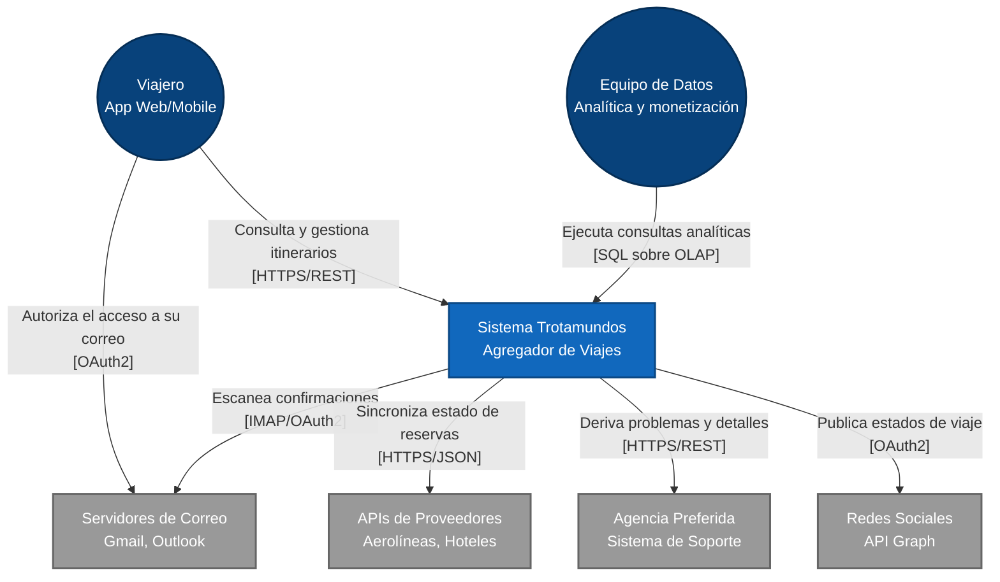
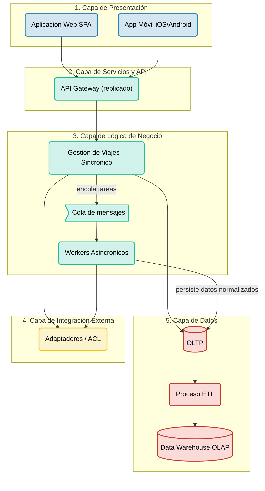

## Iteración 1

## Paso 1: Revisión de entradas

**Entradas:** drivers funcionales, atributos de calidad y restricciones definidos en el análisis inicial (ver página de Drivers) y el diagrama de contexto. Al tratarse de un desarrollo greenfield, **no existe diseño previo**.

- - -

## Paso 2: Establecer el objetivo de la iteración seleccionando los drivers

**Objetivo de la iteración:** definir la estructura base del sistema (capas, despliegue físico y separación de cargas) y dejar sentadas las condiciones para interoperabilidad, mantenibilidad, escalabilidad y disponibilidad, que se refinan en detalle en iteraciones posteriores.

**Drivers seleccionados:**

- **CRN-01 (Estructura General Greenfield):** definir el esqueleto principal que conecta a los usuarios con el backend.
- **CON-01 (Soporte Multiplataforma):** soportar clientes Web y Móviles de forma estandarizada.
- **CRN-02 / QA-01a (Desacoplamiento Asincrónico):** aislar el escaneo de correos del flujo de navegación del usuario. La actualización debe reflejarse en menos de 5 minutos.
- **CRN-03 / UC-03 (Separación de cargas operativa y analítica):** evitar que las consultas analíticas pesadas degraden la experiencia de los usuarios.
- **QA-03 (Interoperabilidad):** aislar al núcleo de los cambios en las APIs de terceros.
- **QA-05 (Evolvability y Mantenibilidad):** facilitar la incorporación futura de nuevos medios de transporte.

**Drivers que condicionan la elección del estilo, pero se resuelven en detalle más adelante:**

- **QA-07 (Escalabilidad)** y **QA-02 (Disponibilidad):** el estilo elegido debe permitir escalar horizontalmente y evitar puntos únicos de falla. El diseño concreto (balanceo, réplicas, failover) se aborda en una iteración posterior.
- **QA-01b / QA-01c (Latencia web y FCP móvil):** la estructura debe permitir cumplirlos; los componentes concretos de frontend y red se definen luego.

**Drivers no tratados en esta iteración:** QA-04 (Seguridad), Usabilidad e Internacionalización, y el módulo avanzado (Opción A o B).

- - -

## Paso 3: Elegir uno o más elementos del sistema a refinar

Dado que "Trotamundos" es un desarrollo *greenfield* y esta es la primera iteración, no existe una estructura previa. El elemento seleccionado para refinar es el **Sistema Trotamundos en su totalidad**: una "caja negra" que se abre para particionarla y definir sus responsabilidades lógicas y físicas iniciales.

- - -

## Paso 4: Elegir los conceptos de diseño que satisfacen los drivers seleccionados

### Estructura general

Se adopta un estilo híbrido: **Arquitectura Lógica en Capas (Layers)** desplegada sobre un modelo físico **Cliente-Servidor Multi-Tier (N-Tier)**.

**Alternativas consideradas para el estilo general** (el detalle se documenta en el ADR-001):

| Alternativa | Motivo por el que no se elige en esta iteración |
|---|---|
| Monolito modular | Se descarta como estilo de despliegue: limita el escalado independiente de las partes con cargas muy distintas (workers, analítica) |
| Microservicios | Se posterga: ofrece más independencia de despliegue, pero agrega complejidad operativa que no es viable para el alcance y el plazo del prototipo |
| Arquitectura orientada a eventos pura | Se adopta solo de forma parcial (cola de mensajes para el procesamiento de correos), no como estilo global |

### Reglas de dependencia entre capas

La comunicación fluye de arriba hacia abajo. La **Capa de Negocio** actúa como orquestador central y accede **directamente** a la Capa de Integración y a la Capa de Datos (acceso a más de una capa inferior, conocido en la bibliografía como *layer bridging*; verificar el término en el material de la cátedra). Se justifica porque obligar a Negocio a pasar por Integración solo para llegar a la base de datos agregaría indirección sin beneficio, ya que Integración se ocupa únicamente de sistemas externos.

Las capas de Presentación y de Servicios/API **no** saltan niveles: Presentación solo habla con la API, y la API solo con Negocio.

### Justificación por driver

| Driver | Concepto de diseño | Cómo lo satisface |
|---|---|---|
| CRN-01 | Arquitectura en capas | Separa presentación, API, negocio, integración y datos, y ordena el desarrollo guiado por especificaciones |
| CON-01 | Cliente-Servidor | Aísla los clientes Web y Móvil de la infraestructura central; se comunican solo por APIs estándar |
| CRN-02 / QA-01a | **Cola de mensajes con consumidores competitivos** | El módulo sincrónico encola las tareas de escaneo y un conjunto de workers las consume; cada tarea la procesa un único worker. Los hilos de respuesta web no se bloquean y la cola amortigua los picos (nivelación de carga) |
| CRN-03 / UC-03 | **Segregación OLTP/OLAP con proceso ETL** | Un ETL traslada datos de forma unidireccional de la base operacional al Data Warehouse, sin cargar al módulo que atiende usuarios |
| QA-03 | **Adaptadores / Anti-Corruption Layer** | La Capa de Integración traduce las comunicaciones externas y protege al núcleo de los cambios de terceros |
| QA-05 | Capas con aislamiento de dependencias externas | Los cambios en proveedores quedan acotados a la Capa de Integración |
| QA-07 / QA-02 | Despliegue Multi-Tier | Cada capa puede desplegarse en nodos independientes; Negocio y los workers pueden escalar horizontalmente sin afectar a clientes ni a las bases de datos |

- - -

## Paso 5: Instanciar elementos arquitectónicos y asignar responsabilidades

Se "abre la caja" del sistema y se instancian cinco capas lógicas, asignándoles las responsabilidades que cubren la funcionalidad primaria (UC-01 gestión automática desde correo, UC-02 gestión manual de reservas, UC-03 analítica).

**1. Capa de Presentación**
*   **Responsabilidad:** renderizar la interfaz, capturar la interacción y mostrar los itinerarios. Es responsable exclusiva de la interfaz de usuario.
*   **Elementos:** Aplicación Web (SPA) y Aplicación Móvil (iOS/Android) (*CON-01*).
*   **Mapeo funcional:** soporta la interacción del **UC-02** (visualizar, crear o modificar reservas manualmente).

**2. Capa de Servicios y API (API Gateway)**
*   **Responsabilidad:** único punto de entrada al backend. Centraliza el enrutamiento, la autenticación y la gestión de sesiones.
*   **Elementos:** API Gateway, que **debe desplegarse replicado** para no constituir un punto único de falla (*QA-02*).
*   **Mapeo funcional:** expone los endpoints que las aplicaciones cliente usan para el **UC-02**.

**3. Capa de Lógica de Negocio (orquestador central)**
*   **Responsabilidad:** ejecutar las reglas core de Trotamundos y orquestar el flujo llamando a los adaptadores y persistiendo luego los datos.
*   **Elementos:**
    *   *Módulo de Gestión de Viajes (sincrónico):* atiende las peticiones en vivo (agrupación de itinerarios y ciclo de vida) para el **UC-02**.
    *   *Cola de mensajes:* recibe las tareas de escaneo y sincronización que encola el módulo sincrónico y absorbe los picos de carga (*QA-01a*, *QA-07*).
    *   *Workers asincrónicos:* consumen tareas de la cola y ejecutan el sondeo y escaneo de correos (*CRN-02*). Escalan independientemente del módulo sincrónico y garantizan el **UC-01** sin bloquear la navegación.

**4. Capa de Integración Externa**
*   **Responsabilidad:** traducir las comunicaciones con sistemas externos y aislar al núcleo de los cambios en las APIs de terceros (*QA-03*). **No interactúa con la base de datos**: devuelve la información normalizada a la Capa de Negocio.
*   **Elementos:** adaptadores (Anti-Corruption Layer) para proveedores de correo (IMAP/OAuth2), aerolíneas y hoteles. Los adaptadores para redes sociales y agencia preferida se instanciarán en una iteración posterior.
*   **Mapeo funcional:** soporta el **UC-01**, normalizando la información de distintas fuentes antes de entregarla a Negocio.

**5. Capa de Datos**
*   **Responsabilidad:** persistencia y recuperación de la información, separando las cargas de trabajo (*CRN-03*).
*   **Elementos:**
    *   *Base de datos operacional (OLTP):* estado actual de viajes, usuarios y configuraciones, para consultas rápidas y en vivo (**UC-01** y **UC-02**).
    *   *Proceso ETL:* traslada de forma unidireccional y periódica los datos del OLTP al Data Warehouse, sin cargar al módulo que atiende usuarios.
    *   *Data Warehouse (OLAP):* base segregada físicamente que consolida tendencias e histórico. Permite al equipo de datos ejecutar consultas pesadas para monetización (**UC-03**) sin degradar la performance de los usuarios activos.

- - -

## Paso 6: Bosquejar vistas y registrar decisiones de diseño

Para esta iteración se presentan dos vistas: la Vista de Contexto y la Vista Estructural de Capas. El diagrama de contexto es un prerrequisito del análisis y se incluye aquí como referencia.

### Vista 1: Diagrama de Contexto (Nivel 1)

Define los límites del sistema Trotamundos y sus interacciones con actores y sistemas externos, lo cual es crítico para visualizar los escenarios de Interoperabilidad (QA-03).

### Vista 2: Diagrama Estructural de Capas (Arquitectura Base)

Ilustra cómo se abre la caja del sistema en 5 capas lógicas. La comunicación fluye de arriba hacia abajo hasta la Capa de Lógica de Negocio, que actúa como orquestador central e interactúa con las capas de Integración y de Datos. Este diseño aísla a los clientes de la persistencia y de los proveedores de terceros, favoreciendo la Mantenibilidad (QA-05).

### Registro de decisiones de diseño clave

- **Aislamiento de capas:** la Capa de Presentación desconoce la existencia de la base de datos y de las APIs de terceros. Todo el tráfico hacia el backend pasa obligatoriamente por la Capa de Servicios (API Gateway).
- **División de cargas:** se separa la ejecución de tareas de usuario (sincrónicas) de las de procesamiento en segundo plano (asincrónicas) dentro de la Capa de Negocio, para proteger la latencia y la escalabilidad (QA-01, QA-07).
- **Cola de mensajes con consumidores competitivos:** desacopla la respuesta rápida al usuario del procesamiento pesado y permite escalar los workers según el largo de la cola (QA-01a).
- **Segregación de datos con ETL:** el almacenamiento operacional (OLTP) se separa física y lógicamente del analítico (OLAP), con un ETL unidireccional entre ambos (CRN-03).
- **Adaptadores sin acceso a datos:** la Capa de Integración solo traduce comunicaciones externas; la persistencia la realiza la Capa de Negocio (QA-03, QA-05).

**ADRs asociados:**

- [ADR-001: Estilo arquitectónico en capas y despliegue Cliente-Servidor Multi-Tier](../adrs/adr-001-estilo-arquitectonico.md)
- [ADR-002: Procesamiento asincrónico mediante cola de mensajes](../adrs/adr-002-procesamiento-asincronico.md)
- [ADR-003: Segregación de datos operacionales y analíticos con ETL](../adrs/adr-003-segregacion-oltp-olap.md)

- - -

## Paso 7: Analizar el diseño actual y evaluar el cumplimiento de los drivers

| Driver (Requerimiento) | Decisión arquitectónica que lo aborda | Estado al final de la Iteración 1 |
| :--- | :--- | :--- |
| **CRN-01** (Estructura general) | Estilo en capas sobre despliegue Cliente-Servidor Multi-Tier (ADR-001) | **Abordado.** |
| **CON-01** (Multiplataforma) | Clientes Web y Móvil aislados detrás de un API Gateway (ADR-001) | **Abordado.** |
| **UC-01 y UC-02** (Gestión automática y manual) | Reparto de responsabilidades en 5 capas, con Negocio como orquestador central | **Parcialmente abordado:** estructura de alto nivel definida; falta diseñar las interfaces y la lógica interna (Iteración 2). |
| **QA-01a y CRN-02** (Performance asincrónica y escaneo de correos) | Cola de mensajes y workers separados del módulo sincrónico (ADR-002) | **Parcialmente abordado:** falta elegir el broker, definir reintentos e idempotencia, y dimensionar los workers para cumplir los 5 minutos. |
| **QA-03a, b, c, d** (Interoperabilidad) | Capa de Integración con adaptadores (Anti-Corruption Layer) gestionada por Negocio | **Parcialmente abordado:** cubre correo, aerolíneas y hoteles; faltan redes sociales y agencia preferida. |
| **QA-05** (Evolvability y Mantenibilidad) | Capas con aislamiento de dependencias externas; adaptadores sin acceso a datos | **Parcialmente abordado:** falta definir el mecanismo de extensión para nuevos medios de transporte. |
| **CRN-03 y UC-03** (Separación de cargas y analítica) | Bases OLTP/OLAP separadas con proceso ETL (ADR-003) | **Parcialmente abordado:** falta definir frecuencia y mecanismo del ETL. |
| **QA-01b, QA-01c** (Latencia web y FCP móvil) | Clientes separados y API Gateway | **Parcialmente abordado:** faltan componentes concretos de frontend y red. |
| **QA-07** (Escalabilidad) | Despliegue Multi-Tier y nivelación de carga con la cola | **Parcialmente abordado:** la estructura permite escalar horizontalmente; faltan balanceo, caché y estrategia de datos. |
| **QA-02** (Disponibilidad) | Ausencia de punto único de falla a nivel de tiers (Gateway replicado) | **Parcialmente abordado:** faltan réplicas, failover y health checks, a definir en una iteración de infraestructura. |
| **QA-04** (Seguridad) | — | **No tratado.** Objetivo propuesto para la Iteración 2. |
| **Usabilidad e Internacionalización** | — | **No tratado.** |
| **Módulo avanzado (Opción A o B)** | — | **No tratado.** |

**Conclusión de la Iteración 1:**
La arquitectura base (Capas + Multi-Tier) sienta las bases para la interoperabilidad, la mantenibilidad y la separación de cargas. Sin embargo, ninguno de los drivers críticos de ejecución (disponibilidad, escalabilidad y latencia) queda resuelto todavía, y para habilitar el desarrollo guiado por especificaciones es indispensable detallar el interior de las capas clave.

**Objetivo propuesto para la Iteración 2:** detallar la Capa de Negocio y la cola de mensajes (incluida la elección del broker), definir el mecanismo del ETL y tratar la seguridad (QA-04), dado que el acceso a los correos y a los itinerarios compartidos condiciona el diseño interno desde el principio.

- - -
