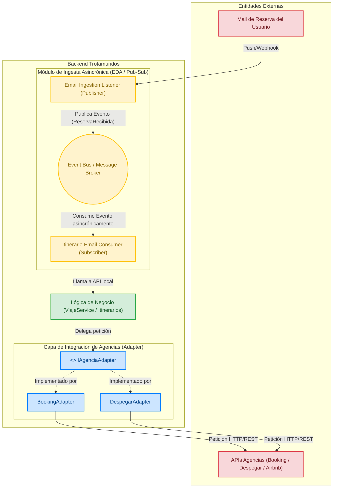

# Iteración 2: Refinamiento de la Lógica Core y las Integraciones

## Paso 1: Revisión de entradas

Se revisan las entradas disponibles al iniciar esta segunda iteración:

*   **Diseño existente (Resultado de la Iteración 1):** Arquitectura base en 5 capas lógicas desplegada sobre un modelo físico Cliente-Servidor Multi-Tier, con segregación de datos OLTP/OLAP y la introducción del patrón de desacoplamiento asincrónico.
*   **Estado del Backlog de Drivers:**
    *   **Completamente Abordados:**
        *   `CRN-01` (Estructura general greenfield).
        *   `CON-01` (Soporte multiplataforma web/móvil).
    *   **Parcialmente Abordados:**
        *   `UC-01` y `UC-02` (Estructura de alto nivel definida; falta la lógica interna y contratos de API).
        *   `QA-01a` / `CRN-02` (Estructura desacoplada definida; falta especificar el broker de mensajes, reintentos y workers).
        *   `QA-03a, b` (Capa de integración definida; falta estructurar adaptadores y parsers específicos).
        *   `QA-05a, b` (Aislamiento conceptual definido; falta el mecanismo de extensión mediante Anti-Corruption Layer).
        *   `CRN-03` / `UC-03` (Segregación OLTP/OLAP definida; falta el mecanismo de sincronización ETL).
        *   `QA-01b, c` (Falta definir componentes concretos de red y optimizaciones de frontend).
        *   `QA-02` y `QA-07` (Estructura Multi-Tier lista; falta la topología de redundancia y auto-escalado).
    *   **No Tratados:**
        *   `QA-04a, b, c, d` (Seguridad y privacidad).
        *   `QA-06` (Usabilidad y Módulo Internacionalización).

## Paso 2: Establecer el objetivo de la iteración seleccionando los drivers

**Objetivo de la iteración:** Diseñar la estructura interna de la **Capa de Lógica de Negocio** y de la **Capa de Integración Externa**, detallando la arquitectura del broker de mensajes, los adaptadores mediante el patrón *Anti-Corruption Layer (ACL)* y los submódulos de dominio necesarios para soportar los casos de uso principales (`UC-01` y `UC-02`) y permitir el desarrollo guiado por especificaciones (*Spec-Driven Development*).

**Drivers seleccionados para abordar en esta iteración:**
*   **UC-01 — Unificación e Integración Automática de Reservas:** Ingesta y escaneo asincrónico de correos de usuarios.
*   **UC-02 — Gestión Manual y Ciclo de Vida del Viaje:** Creación, edición, eliminación y agrupación manual de reservas por itinerario.
*   **QA-01a — Performance Asincrónica:** Garantizar que las actualizaciones de correos se procesen y reflejen en el itinerario en menos de 5 minutos.
*   **QA-03a/b — Interoperabilidad:** Conexión con servidores de correo (OAuth2/IMAP) y APIs de proveedores (aerolíneas, hoteles).
*   **QA-05a/b — Evolucionabilidad y Mantenibilidad:** Aislar los cambios en formatos de respuesta o políticas de proveedores externos dentro de adaptadores dedicados.
*   **CON-02 — Protocolos de Correo:** Respetar OAuth2 e IMAP para el escaneo de e-mails.
*   **CON-03 — Spec-Driven Development:** Definir contratos claros entre componentes que permitan especificar las APIs antes de la codificación.

## Paso 3: Elegir uno o más elementos del sistema a refinar

De las 5 capas lógicas instanciadas en la Iteración 1, se seleccionan dos capas para realizar un refinamiento interno (*zoom-in*):

1.  **Capa de Lógica de Negocio:** Se abre el "orquestador central" para definir los servicios sincrónicos de itinerario, la cola de mensajes y los componentes consumidores (*Workers*).
2.  **Capa de Integración Externa:** Se abren los adaptadores para precisar cómo se traducen e ingresan los datos de terceros hacia el modelo de dominio intern

## Paso 4: Elegir los conceptos de diseño que satisfacen los drivers seleccionados

Para dar soporte a la lógica core y a las integraciones del sistema (resolviendo los *drivers* priorizados para esta iteración), se evalúan y seleccionan patrones arquitectónicos y tácticas específicas de atributos de calidad basados en el catálogo de Bass et al.

A continuación, se detallan los dos conceptos de diseño principales seleccionados, las alternativas descartadas, sus pros/contras y los *drivers* que abordan.

### 1. Patrón: Anti-Corruption Layer (ACL) / Adaptadores (Wrappers)
**Táctica Asociada:** *Tailor Interface / Encapsulate* (Empaquetar / Aislar Cambios).

* **Por qué elegimos esta opción:** 
  Las APIs de proveedores externos (aerolíneas, hoteles, Gmail, Outlook) tienen modelos de datos heterogéneos y políticas que cambian con frecuencia. Necesitamos una capa traductora mediadora que envase esta complejidad en un "wrapper" (adaptador) y convierta las respuestas a un modelo de dominio interno canonizado (*TravelReservationDTO*). Esto aísla completamente el núcleo del backend, limitando la "onda de choque" de cualquier cambio externo a un único componente aislado.
* **Drivers que aborda:** 
  * **QA-05a / QA-05b** (Evolucionabilidad y Mantenibilidad)[cite: 8].
  * **QA-03a / QA-03b** (Interoperabilidad con proveedores y correos)[cite: 8].

| Opción Evaluada | Pros | Contras | Decisión |
| :--- | :--- | :--- | :--- |
| **Opción A: Anti-Corruption Layer (ACL) y Adaptadores** | - Aísla al Core del sistema de cambios externos.<br>- Permite resolver actualizaciones de terceros en menos de 2 días-persona (**QA-05b**)[cite: 8].<br>- Facilita agregar nuevos transportes sin tocar el código central (**QA-05a**)[cite: 8]. | - Introduce un ligero *overhead* de procesamiento por la traducción de datos.<br>- Requiere mayor esfuerzo inicial para definir los DTOs neutros y mapeadores. | **Seleccionada.** |
| **Opción B: Integración Directa (Punto a Punto)** | - Desarrollo inicial más rápido.<br>- Menor cantidad de clases y abstracciones en el código. | - Alto acoplamiento. Cualquier cambio en la API de Iberia o Gmail rompe la lógica de negocio core.<br>- Imposibilita cumplir con la mantenibilidad requerida (**QA-05**)[cite: 8]. | *Descartada.* |

---

### 2. Patrón: Publish-Subscribe / Broker de Mensajes (Cola Asincrónica)
**Táctica Asociada:** *Asynchronous Interaction / Manage Queue Size* (Manejo de Respuestas Asincrónicas).

* **Por qué elegimos esta opción:** 
  El escaneo y *parsing* de correos es un proceso pesado. Si se hiciera de forma sincrónica, bloquearía los hilos HTTP del servidor. Al usar un patrón orientado a eventos (*Event-Driven*) con un *Broker* de mensajes, los emisores publican eventos ("nuevo correo detectado") en una cola sin conocer a los receptores. Los *workers* consumen estos eventos de forma totalmente desacoplada, nivelando la carga (*load leveling*) para garantizar que los itinerarios se reflejen en menos de 5 minutos sin degradar la latencia de navegación de los usuarios web/móvil.
* **Drivers que aborda:** 
  * **QA-01a** (Performance - Sincronización asincrónica en menos de 5 minutos)[cite: 8].
  * **CRN-02** (Desacoplamiento de procesamiento asincrónico)[cite: 8].
  * **QA-07a** (Escalabilidad - Amortiguación de picos extremos)[cite: 7, 8].

| Opción Evaluada | Pros | Contras | Decisión |
| :--- | :--- | :--- | :--- |
| **Opción A: Publish-Subscribe mediante Broker de Mensajes** | - Desacopla totalmente la recepción del procesamiento pesado.<br>- Amortigua picos de tráfico (Backpressure) mediante consumidores competitivos[cite: 7, 8].<br>- Garantiza que los hilos HTTP del usuario no se bloqueen. | - Añade complejidad de infraestructura (hay que desplegar y mantener un Broker como RabbitMQ o Kafka).<br>- La depuración (debugging) de errores asincrónicos es más compleja. | **Seleccionada.** |
| **Opción B: Procesamiento Sincrónico Directo o Hilos Locales (In-Memory)** | - Arquitectura mucho más simple (sin infraestructura extra).<br>- Trazabilidad y debugging directo en el mismo hilo de ejecución. | - Ante un pico de correos, los hilos de memoria se agotan y el servidor colapsa (**QA-07a**)[cite: 8].<br>- Si el servidor se reinicia, se pierden las tareas en memoria (falta de durabilidad). | *Descartada.* |

---

## Paso 5: Instanciar elementos arquitectónicos y asignar responsabilidades

A partir de los patrones y tácticas seleccionados en el Paso 4 (*Anti-Corruption Layer*, *Publish-Subscribe*, *Domain Model* y *Service Application Reference Architecture*), procedemos a hacer "zoom-in" e instanciar los componentes internos. Nos concentraremos principalmente en la Capa de Lógica de Negocio y la Capa de Integración Externa, explicando cómo estas decisiones impactan en el resto de la arquitectura.

### 1. Capa de Presentación
*   **Influencia de los Patrones:** Gracias a la *Service Application Reference Architecture*, esta capa permanece totalmente aislada de la complejidad del backend y de las reglas de negocio.
*   **Elementos y Responsabilidades:** Instancia las interfaces de usuario (Web SPA y Mobile). Se comunica única y exclusivamente enviando y recibiendo **DTOs (Data Transfer Objects) planos** a través de contratos estándar (REST/JSON), ignorando por completo cómo se procesan o guardan los datos.

### 2. Capa de Servicios y API (API Gateway)
*   **Influencia de los Patrones:** Mantiene su rol de único punto de entrada estandarizado para proteger las interfaces.
*   **Elementos y Responsabilidades:** Enruta las peticiones HTTP entrantes desde la Capa de Presentación directamente hacia los *Controllers* correspondientes en la Capa de Lógica de Negocio, manejando en el futuro la seguridad y limitación de tasa (*rate limiting*).

### 3. Capa de Lógica de Negocio (Backend Core / Orquestador Central)
Aquí se instancian los patrones *Domain Model* y *Publish-Subscribe*, desglosando el núcleo del sistema en componentes altamente cohesivos:
*   **Controllers (API REST Layer):** Exponen los endpoints. Reciben los DTOs desde el Gateway, realizan validaciones sintácticas básicas y delegan la ejecución a la capa de servicios.
*   **Itinerary Domain Service (Orquestador Sincrónico):** Gestiona los flujos de la aplicación (`UC-02`). No implementa reglas de negocio complejas directamente, sino que coordina la recuperación de entidades, invoca sus métodos y delega la persistencia.
*   **Domain Model (Entidades Ricas - DDD):** Es el corazón del sistema. Entidades como `Itinerary`, `FlightReservation` o `HotelReservation` agrupan de forma cohesiva los atributos y las reglas estrictas del negocio (ej. validación de fechas, cálculo de solapamientos). Son totalmente agnósticas a la base de datos o la interfaz.
*   **Message Broker (Cola Asincrónica - Pub/Sub):** Infraestructura de mensajería (ej. RabbitMQ o Kafka) que absorbe la carga pesada (`QA-01a`). Gestiona colas específicas como `email-scan-tasks` (órdenes de sondeo) y `raw-email-events` (correos descargados pendientes de procesamiento).
*   **Workers Asincrónicos (Email Ingestion & Parsing Worker):** Consumidores competitivos que procesan eventos de la cola en segundo plano (`UC-01`). Al finalizar el *parsing*, invocan al *Itinerary Domain Service* para consolidar la reserva, re-utilizando así exactamente la misma lógica de dominio que el flujo sincrónico.

### 4. Capa de Integración Externa
*   **Influencia de los Patrones:** Se materializa directamente el patrón *Anti-Corruption Layer (ACL)* y la táctica *Tailor Interface*.
*   **Elementos y Responsabilidades:** Actúa como mediadora y traductora estricta. Se instancian:
    *   **Mail Provider Adapters (OAuth2/IMAP):** Encapsulan la complejidad de conexión técnica con Gmail o Outlook.
    *   **Travel API Adapters:** Wrappers para absorber los cambios de aerolíneas y hoteles (`QA-05`).
    *   **ACL Engine:** Toma los datos crudos y heterogéneos (XML, JSON externo o correos MIME) y los traduce al DTO interno canonizado (`TravelReservationDTO`).
    *   *Restricción ratificada:* Como establece la arquitectura base (*Layer Bridging*), **ningún componente de esta capa accede a la base de datos**; todo se retorna a la Capa de Negocio.

### 5. Capa de Datos (Persistencia)
*   **Influencia de los Patrones:** Da soporte directo a la persistencia del *Domain Model* sin contaminarlo con lógica SQL.


*   **Elementos y Responsabilidades:** El acceso a la Base de Datos Operacional (OLTP) se realiza mediante **Repositorios (Data Access Layer)**. Estos repositorios actúan como mapeadores (Data Mappers / ORM), encargándose de transformar las filas relacionales de las tablas en instancias vivas de las entidades del modelo de dominio, aislando al núcleo del sistema de los detalles del motor de base de datos.

### Paso 6: Definir Interfaces y Vistas Arquitectónicas (C&C y Módulos)
En este paso se formalizan los contratos de interfaz y se construyen las vistas estáticas y dinámicas que documentan el comportamiento de la capa de integración de agencias (patrón Adapter) y el procesamiento asincrónico de correos (patrón Publisher-Subscriber).

### Vista 1: Vista C&C (Componentes y Conectores - Tiempo de Ejecución)
Esta vista modela el comportamiento dinámico del sistema en tiempo de ejecución, mostrando cómo fluyen las peticiones de integración y los eventos asincrónicos de correos a través de la red y el bus de mensajes.



#### Leyenda y Explicación de la Vista 1 (C&C)
*   **UserMail → EmailIngestion (Webhook/IMAP):** Entrada del correo enviado por el usuario con su comprobante de reserva.
*   **EmailIngestion (Publisher):** Recibe el correo bruto, extrae los metadatos básicos y publica un evento `NuevoMailReservaEvent` de forma asincrónica.
*   **EventBus (Message Broker):** Conector de desacoplamiento temporal y espacial que distribuye eventos a los suscriptores interesados.
*   **EmailSubscriber (Subscriber):** Escucha el tópico de eventos de correo, parsea la información y convoca a la lógica de dominio.
*   **IAgenciaAdapter + Adaptadores:** Capa intermedia que homogeneiza las respuestas heterogéneas de las APIs externas (Booking, Despegar) hacia un modelo de datos unificado dentro de Trotamundos.
*   **Leyenda de Colores del Gráfico:** **Rojo:** Entidades Externas | **Amarillo:** Módulo Pub/Sub |  **Verde:** Core de Negocio |  **Azul:** Adaptadores e Interfaces.

---

### Vista 2: Vista de Módulos (Estructura de Código / Clases e Interfaces)
Esta vista representa la organización estática del código fuente, las interfaces y las relaciones de dependencia bajo la regla de dependencias allowed-to-use.

**Leyenda de Colores:**  **Verde:** Lógica de Negocio |  **Amarillo:** Eventos Pub/Sub |  **Gris Punteado:** Interfaces |  **Violeta:** Implementaciones de Adaptadores.

```mermaid
classDiagram
    class ViajeService {
        +procesarReservaMail(datosReserva)
        +sincronizarConAgencia(agenciaId)
    }

    class IAgenciaAdapter {
        <<interface>>
        +obtenerDetallesReserva(reservaId)
        +sincronizarItinerario(usuarioId)
    }

    class BookingAdapter {
        -apiClient
        +obtenerDetallesReserva(reservaId)
        +sincronizarItinerario(usuarioId)
    }

    class DespegarAdapter {
        -apiClient
        +obtenerDetallesReserva(reservaId)
        +sincronizarItinerario(usuarioId)
    }
    
    class EmailIngestionListener {
        +recibirEmail(payload)
        +publicarEventoEnBus(evento)
    }

    class ItinerarioEmailConsumer {
        +consumirEvento(mensaje)
        +extraerDatosViaje(mensaje)
    }

    %% Relaciones de dependencia (allowed-to-use) y realización
    ItinerarioEmailConsumer --> ViajeService : invoca
    ViajeService --> IAgenciaAdapter : usa
    
    IAgenciaAdapter <|.. BookingAdapter : implementa
    IAgenciaAdapter <|.. DespegarAdapter : implementa

    %% Aplicación de colores directos a las clases
    style ViajeService fill:#d4edda,stroke:#28a745,stroke-width:2px,color:#155724
    
    style EmailIngestionListener fill:#fff3cd,stroke:#ffc107,stroke-width:2px,color:#856404
    style ItinerarioEmailConsumer fill:#fff3cd,stroke:#ffc107,stroke-width:2px,color:#856404
    
    style IAgenciaAdapter fill:#f8f9fa,stroke:#6c757d,stroke-width:2px,color:#495057,stroke-dasharray: 5 5
    
    style BookingAdapter fill:#e2d9f3,stroke:#6f42c1,stroke-width:2px
